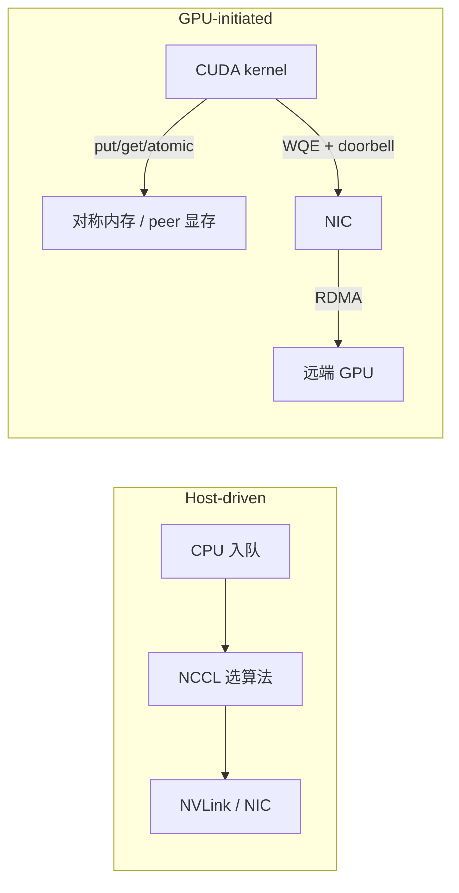

# GPU 发起通信专题：NVSHMEM、GPUNetIO 与内核内融合

> **面向**：读完 [通信与网络专题](./通信与网络专题.md) 的读者——你已经知道
> NVLink/IB 的带宽分层、NCCL Ring/Tree、DeepEP 的 all-to-all。本篇补上
> 2026 年 AI Infra 面试越来越常追问的另一半：**让 CUDA kernel 自己发起通信**。
> 它不是替代 NCCL，而是补 NCCL 不擅长的细粒度、数据依赖、延迟敏感路径。
>
> **读完获得**：① 一句话分清 host-driven / device-initiated；② NVSHMEM 的
> 对称内存、快慢路径与 DeepEP 的「基板」用法；③ GPUNetIO 的 WQE→doorbell→
> CQE 数据路径；④ mKernel 如何把计算、NVLink、RDMA 融进一个持久内核；
> ⑤ 小消息 AllReduce 的四类无屏障协议；⑥ 选型表与六道面试答法。
>
> **时效口径**：素材来自 2026-07～2026-10 的论文与公开拆解（NVSHMEM 论文
> arXiv 2606.05951、mKernel arXiv 2609.13585、低延迟集合通信 arXiv
> 2607.16100、NVIDIA DOCA GPUNetIO 博客），数字为原文实验口径，本仓未复测；
> 版本与硬件配置在文末「口径与未核实说明」列出。

## 一、一句话主线：CPU 不该站在每次通信的关键路径上

NCCL 的主流用法是 **host-driven**：CPU 调用 `ncclAllReduce`，库选算法、
排 kernel、调度网卡。对 bulk-synchronous 的集合通信（训练里的大 AllReduce）
这套非常有效；但遇到下面几类模式就难受：

- 通信量**数据依赖**：MoE 每个 token 选不同专家，all-to-all 的大小和目的地
  每层都在变；
- 通信只发生在**部分线程/部分 tile**：计算 kernel 里算完一个 tile 就想发；
- 延迟以**微秒**计：长上下文 decode 的小 batch TP，AllReduce 频繁且消息小，
  CPU 入队 + kernel launch 的开销就吃掉大头；
- 想把通信**折进计算 kernel**：CPU 驱动的集合通信很难和 tile 级计算重叠。

GPU 发起通信（GPU-initiated / device-initiated）把发起权交给 CUDA kernel：
kernel 直接对远端显存做 put/get/atomic，或直接提交 RDMA 工作请求，CPU 只
负责建连、注册内存等控制面。一句话对比：

| | Host-driven NCCL | GPU-initiated |
|---|---|---|
| 谁发起 | CPU 入队 collective | CUDA kernel 内的线程 |
| 适合 | 大消息、规整集合通信 | 小消息、细粒度、数据依赖、不规则 |
| 优势 | 成熟、算法全、跨平台 | 延迟低、可与计算 tile 级重叠 |
| 代价 | CPU 在关键路径；难表达不规则 | 编程复杂、内存序/同步要自己管 |

本篇按三层展开：**编程模型**（NVSHMEM）、**传输底座**（GPUNetIO/IBGDA）、
**内核融合**（mKernel）。



（图：host-driven 把 CPU 放在每次通信的入口；GPU-initiated 让 kernel 直接
碰内存或网卡，CPU 退到控制面。）

## 二、先分清五个概念

面试里最容易把 P2P、GDRDMA、GDA-KI、NVSHMEM 混成一团。用一张表钉死：

| 概念 | 一句话 | 边界 |
|---|---|---|
| **P2P（peer-to-peer）** | 一张 GPU 直接 load/store 另一张 GPU 的显存 | 通常限同机、同一 PCIe/NVLink 域 |
| **GPUDirect RDMA（GDRDMA）** | 网卡直接读写 GPU 显存，不经过 CPU 内存 | 跨节点；解决「数据先落主机内存」的拷贝 |
| **GDA-KI** | GPU kernel 直接发起网络操作（提交 WQE、敲门铃） | 需要网卡支持；CPU 只做控制面 |
| **IBGDA** | GDA-KI 在 InfiniBand 上的实现 | NVSHMEM 的慢路径可用它 |
| **NVSHMEM** | NVIDIA 的 PGAS 库：对称内存 + one-sided put/get/atomic | 编程模型；底层可走 P2P、IBGDA 或 host 代理 |
| **NCCL GIN** | NCCL 的 GPU-Initiated Networking 设备 API | NCCL 生态内的 device-initiated 集合通信 |

记忆顺序：**P2P 是显存互访，GDRDMA 是网卡互访，GDA-KI 是 kernel 发起网络，
NVSHMEM 是把这些能力包装成 PGAS 编程模型。**

## 三、NVSHMEM：对称内存是全部设计的支点

### 3.1 对称堆与远程地址

NVSHMEM 把每个 PE（通常是一张 GPU 上的一个进程）的一块显存做成**对称堆**：
同一对象在所有 PE 上以相同类型、大小、布局分配。于是远程地址不需要交换
指针，只需要一个偏移：

```text
远程地址 = 远端堆基址 + (本地指针 - 本地堆基址)
```

这个「对称偏移规则」是快慢路径共用的寻址方案。快路径直接解引用，慢路径把
偏移、内存句柄/注册信息交给传输层。

### 3.2 快路径与慢路径

| 路径 | 触发条件 | 怎么完成 | 性能直觉 |
|---|---|---|---|
| **快路径（P2P）** | 目标 PE 与本地同机、`cudaDeviceCanAccessPeer` 可直连 | 把 peer 堆映射进本地 VA，SM 直接 load/store | 最低延迟；受 NVLink/PCIe 带宽约束 |
| **慢路径（IBGDA）** | 跨节点，或同机但 P2P 不可达 | GPU 构造 RDMA 工作请求，网卡执行 | 跨节点主力；小消息延迟微秒级 |
| **慢路径（host 代理）** | 网卡不支持 GDA-KI | GPU 写命令队列，CPU 代理线程提交 | 兼容性最好；多一跳 |

注意：慢路径在 API 层仍然是「GPU 发起」——kernel 调 `nvshmem_put`，只是最终
由网卡或主机代理完成。这就是为什么 NVSHMEM 的语义统一，性能却分档。

### 3.3 微基准：bulk 写是甜点，标量 get 是陷阱

H200 集群、NVSHMEM 3.3.9、CUDA 13.0.88 的原文数据：

| 场景 | 带宽/延迟 | 说明 |
|---|---|---|
| 节点内 bulk put | **313 GB/s** | 接近但低于 NVLink 450 GB/s 参考 |
| 节点内 bulk get | **141 GB/s** | 读路径更贵 |
| 节点内标量 put | **172 GB/s** | 大量线程独立 store 可重叠 |
| 节点内标量 get | **<9 GB/s** | 每次 load 要等返回值，流水线打不深 |
| 跨节点 bulk put/get | **48.0 / 48.2 GB/s** | 逼近单轨 IB 参考 |
| 跨节点标量 put / get | **15.6 / 1.28 GB/s** | 标量 get 尤其不适合带宽场景 |
| 节点内延迟 | **1.8～2.5 μs**（bulk）/ 1.3～2.2 μs（标量） | 原文口径 |
| 跨节点延迟 | **9.4～9.7 μs**（256B～64KiB） | 原文口径 |

结论一句话：**NVSHMEM 对 bulk 或聚合写最有效；标量操作只该用来做控制、
通知、信用更新，不要拿标量 get 当带宽原语。**

### 3.4 Collectives 的边界：设备端单 CTA 打不满

NVSHMEM 也有 collectives（AllReduce、ReduceScatter 等），但设备端 API 是
**threadgroup 作用域**：一次 collective 由一个 threadgroup（通常是单 CTA）
执行，没有公开的 grid 作用域变体。结果是节点内设备端 AllReduce 只有
**30 GB/s**，而 host 端 on-stream 路径有 **264 GB/s**，接近 NCCL NVLS 的
**276 GB/s**；跨节点 NVSHMEM collective 更是低于 **0.20 GB/s**，而 NCCL
ring/NVLS 能到 **180/252 GB/s**。

所以别把 NVSHMEM 当「NCCL 替代品」。它的定位是：**NCCL 不擅长的细粒度
one-sided 通信**；集合通信仍然交给 NCCL（或 NCCL GIN）。

### 3.5 DeepEP：把 NVSHMEM 当基板，而不是全家桶

DeepEP 是 DeepSeek 为 MoE expert parallelism 写的通信库。它的做法很有
代表性：

- **高吞吐（HT）路径**（训练）：8 个并行 NVSHMEM world team，每个 team
  每节点一个 PE；token 先在同 local index 的 GPU 间跨节点 RDMA，再在目标
  节点内用 NVLink 重分发到承载专家的 GPU。kernel 内用 warp specialization：
  RDMA 发送、协调、NVLink 接收各司其职。
- **低延迟（LL）路径**（推理）：去掉节点内转发，跨节点直接 RDMA；单个全局
  world team，按 local expert 划分 SM；关键路径只保留一次 IBGDA put 搬负载
  + 一次原子更新通知计数。

DeepEP **没有**把大部分工作写成 NVSHMEM collective 或通用 RMA 调用，只在
跨节点 RDMA 的关键点用 NVSHMEM：元数据交换、分块 put、远端头尾计数器的
原子信用更新。上层自建多级流水线。这就是「基板」用法：**用 NVSHMEM 的
one-sided 能力打底，集合语义和流水线自己写。**

## 四、GPUNetIO：把 GDA-KI 收敛成一份公共底座

### 4.1 它解决什么

在 GPUNetIO 之前，NCCL、NVSHMEM、UCX/NIXL 各自维护一套 GDA-KI 风格的
GPU 发起 RDMA：各自假设、各自代码、各自修 bug。GPUNetIO 把这些收进一份
公共实现：CPU 控制路径导出传输对象，GPU 数据路径直接操作网卡。

### 4.2 编程模型：控制面在 CPU，数据面在 GPU

**CPU 控制路径**（建连一次）：

1. 初始化 GPU 与网卡、分配内存；
2. 建网络传输对象（DOCA Verbs / Ethernet 的 QP、SQ、CQ）；
3. 把队列对象导出成 GPU 内存里的 descriptor；
4. launch CUDA kernel，把 descriptor 当参数传进去。

**GPU 数据路径**（每个 kernel 反复跑）三步：

```text
提交 WQE（RDMA Write/Read、Ethernet Send/Recv）
  → 敲门铃（写网卡寄存器，通知有新 WQE）
  → 轮询 CQE（可选，等完成）
```

高阶 API 把「提交 + 门铃 + 并发保护」打包好（如
`doca_gpu_dev_verbs_put_signal`、`doca_gpu_dev_eth_txq_send`），线程安全；
低阶 API 只给 building block，同队列并发要自己同步。

门铃有三种：常规 MMIO 门铃、BlueFlame（把整个 WQE 写进网卡寄存器，低延迟）、
CPU 辅助门铃（GPU 写共享内存，CPU 轮询后敲门铃，给没有 GPU 直连网卡的系统）。

### 4.3 生态：NCCL GIN、NVSHMEM 3.7、NVQLink 都建在它上面

- **NCCL 2.27+ GIN**：GPU-Initiated Networking 设备 API（put/get/signal/
  wait/flush），后端就是开源 GPUNetIO Verbs 路径；
- **NVSHMEM 3.7+**：新增 GPUNetIO 传输，设
  `NVSHMEM_REMOTE_TRANSPORT=gpunetio`、`NVSHMEM_GPUNETIO_ENABLE_GDAKI=1`；
- **UCX/NIXL、NVQLink、DeepEP/HybridEP** 也在同一底座上。

原文的 NVQLink 转发实测：FPGA 侧往返延迟最小约 **2.6 μs**、中位 **2.7 μs**。
另一个关键对比：关了 GDA-KI 时，小消息带宽加 CTA/QP 也上不去（CPU 代理
是瓶颈）；开了之后带宽随 CTA 数增长、峰值更早到顶。

### 4.4 面试怎么答

被问「GPU kernel 怎么在不经过 CPU 的情况下发网络包」，答三步：
**CPU 控制面建 QP/注册内存 → kernel 提交 WQE → 敲门铃 → 轮询 CQE**。
CPU 不是完全消失，而是退出每笔事务的关键路径。

## 五、mKernel：把计算、NVLink、RDMA 塞进一个持久内核

### 5.1 问题：通信已经吃掉三成训练时间

原文给出的数字：生产 MoE 训练里，通信占前向计算 **43.6%**、端到端训练时间
**32%**，主流框架里最高能到 **47%**。同时跨节点网卡只有 **400～800 Gb/s**
（50～100 GB/s），而机内 NVLink 是 **450 GB/s 量级**（原文单向口径，双向
约 900 GB/s）——两级带宽差约 **9 倍**。传统做法要么先做节点内融合再做一次
跨节点 collective，要么用双流按 chunk 重叠；前者跨节点仍是独立 kernel，
后者只能在内核边界释放 chunk。

### 5.2 设计：SM 角色专精 + tile/chunk 解耦

mKernel 让每张 GPU 跑一个**持久内核**，把线程块按角色分工：

- **计算块**：继续算 GEMM/attention 的 tile，算完写显存并设就绪标志；
- **节点内通信块**：通过 NVLink/NVSwitch 做本地归约、广播；
- **跨节点发送块**：把传输命令写进主机 pinned 内存的命令队列；
- **接收块**：轮询到达标志，消费远端数据；
- **主机代理**：把命令批量提交给网卡（最多 8 条一批），数据本身始终在
  GPU 显存里。

两个关键解耦：

1. **tile 就绪 ≠ 消息就绪**：本地 tile 可以独立就绪，但要攒成足够大的网络
   chunk 才发。GEMM+AllReduce 用 **256 KiB** 网络 chunk；Dispatch+GEMM 用
   **512 KiB** chunk，跨 chunk 边界的 token 要等两条远端消息都到。
2. **SM 分配自适应**：通信和计算抢 SM。原文的静态扫描里，最佳通信 SM 数
   从 **2 到 64** 浮动；mKernel 用控制器按剩余工作量和单任务开销估计，在
   执行中动态切换角色。

### 5.3 五个约束（面试可展开）

| 约束 | 一句话 | 设计回应 |
|---|---|---|
| C1 带宽不对称 | 跨节点约为 NVLink 的 1/9 | 先在 NVSwitch 做本地归约/广播，减少跨节点流量 |
| C2 粒度不对称 | 节点内是内存语义，跨节点是消息语义 | tile 与网络 chunk 分开定尺寸，攒批摊薄消息开销 |
| C3 顺序语义不同 | IB RC 保序；AWS EFA SRD 不保序 | IB 先数据后标志；EFA 用带 immediate 的写 + 代理发标志 |
| C4 跨设备同步 | 网络完成 ≠ 显存可见 | 就绪标志 + 内存序，避免全局同步 |
| C5 SM 分配随负载变 | 输入形状、负载组合都会影响最佳划分 | 运行时自适应控制器 |

### 5.4 结果与反直觉结论

- GEMM+AllReduce 最高 **1.72×**；Ring Attention **1.88×**；
- 两个 16 卡 H200 集群（IB 与 AWS EFA 各一）验证；
- **反直觉**：在他们测试的场景里，GPUDirect Async（IBGDA）相对主机代理
  几乎没有性能收益，甚至批量化上更省心——主机代理把提交和计算重叠、还能
  批量提交，而 IBGDA 每个 chunk 要付昂贵的 GPU fence + doorbell。IBGDA 更
  适合小消息、延迟敏感负载。

## 六、小消息 AllReduce：延迟优化是「删同步」，不是「加带宽」

长上下文 decode 的 TP 推理里，batch 小、AllReduce 频繁且消息小，瓶颈是
延迟而非带宽。原文测量：NCCL 的 `ncclLsaBarrierSession` 每次屏障超过
**1 μs**，很多 AllReduce 内核要两个屏障，占总延迟 **40%**。

四种无屏障/少屏障技术，按消息大小分工：

| 技术 | 机制 | 适用 | 代价 |
|---|---|---|---|
| **LL 协议** | 8B 标志 + 8B 数据打包成 16B 原子写，接收方轮询标志 | 极小消息 | 有效载荷带宽减半、scratch 翻倍 |
| **哨兵同步** | scratch 预填 -NaN，数据直接写，轮询到值变化即就绪 | 中等消息 | 每轮要重置；传输值不能等于哨兵 |
| **双向通信 + 双缓冲** | 收到对端数据即视为下一次发送的许可（信用流控） | 多次归约迭代 | 需要双 buffer 管理 |
| **LL128 Atomic** | 8 行一组处理 128B cache line，用 atomic add 做标志 | 4KB～256KB | 仅 NVLink、仅 FP16/BF16、结果非确定性 |

原文结果：

- 4×GB200 小消息 AllReduce：NCCL **11.0 μs** → **2.37 μs**，距硬件 SoL
  下限仅 **7%**；
- 8×H100：**18.0 μs** → **5.6 μs**；
- Llama-3.1-70B vLLM（4×GB200）：ITL **28.7 ms → 26.2 ms（-8.7%）**，
  吞吐 **+9.5%**；
- cuSOLVERMp（8×H100，10000×10000）：**1.82 s → 0.78 s（2.3×）**。

一句话总结：**小消息延迟的主战场是屏障和同步；带宽优化是第二顺位。**

## 七、选型表：什么时候用哪一层

| 方案 | 适用 | 不适用/代价 |
|---|---|---|
| **NCCL host-driven** | 训练/推理的大消息集合通信；跨平台、成熟 | 小消息、不规则、数据依赖通信 CPU 成瓶颈 |
| **NCCL GIN（device API）** | 想留在 NCCL 生态内做设备发起集合通信 | 仍受 NCCL 算法/语义边界约束 |
| **NVSHMEM** | 细粒度 point-to-point、one-sided、PGAS、不规则交换 | 不要拿它替代 NCCL collective；跨节点 collective 弱 |
| **GPUNetIO** | 自己写 GDA-KI 传输；NCCL/NVSHMEM 已用它做底座 | 直接用它写业务通信门槛高，优先经上层库 |
| **mKernel** | 计算 + 通信要 tile 级重叠、愿意自己管 SM 预算 | 复杂度高；平台传输语义差异要自己抹平 |
| **Green Contexts** | 进程内把 SM 硬切给延迟敏感/吞吐负载 | 不是通信库；bulk 侧可用 SM 变少（见[集群调度篇](../集群调度与资源管理专题.md)） |

## 八、▶ 面试题（六道）

> 下面六题是 2026 年 AI Infra 的**新题块**，按论文/官方博客口径整理，
> 不是某场面试实录；答法里的数字引用时先说明来源。

**Q1【高 · 新题块】NCCL 是 host-driven 的，为什么还需要 GPU 发起通信？**
「NCCL 由 CPU 入队 collective、库选算法，适合大消息、规整的集合通信。
但 MoE 的 all-to-all 大小和目的地数据依赖、decode 的小消息 AllReduce
延迟敏感、计算 kernel 想按 tile 发数据——这些场景 CPU 在关键路径上
就是瓶颈。GPU 发起让 kernel 直接 put/get/atomic 或提交 RDMA，CPU 退到
建连/注册的控制面，换来更低延迟和 tile 级重叠。」

**Q2【高 · 新题块】NVSHMEM 的对称内存是什么？远程地址怎么算？快慢路径怎么选？**
「每个 PE 的对称堆按相同类型/大小/布局分配，远程地址 = 远端堆基址 +
（本地指针 - 本地堆基址）。目标 P2P 可达时走快路径：peer 堆映射进本地
VA，SM 直接 load/store；不可达时走慢路径：IBGDA 由 GPU 提交 RDMA，
或 host 代理线程消费命令队列。两条路径共用对称偏移，只是基址和完成
机制不同。」

**Q3【高 · 新题块】GPUNetIO 的 GPU 数据路径有哪三步？CPU 还在做什么？**
「提交 WQE → 敲门铃 → 轮询 CQE。CPU 在控制面建 QP、注册内存、把队列
descriptor 导出到 GPU 内存；每笔事务的数据面由 CUDA kernel 直接驱动网卡，
CPU 不在关键路径。门铃有 MMIO、BlueFlame、CPU 辅助三种，后者给没有
GPU 直连网卡的系统用。」

**Q4【高 · 新题块】mKernel 怎么把计算、NVLink、RDMA 融进一个内核？为什么
GPUDirect Async 不一定更快？**
「每张 GPU 跑持久内核，线程块按计算/节点内通信/跨节点提交/接收分工；
计算块算完 tile 设就绪标志，节点内用 NVSwitch 归约/广播，跨节点把命令
写进主机 pinned 队列，由代理批量提交网卡；tile 和网络 chunk 分开定尺寸，
SM 分配运行时自适应。反直觉的是，原文测试里 IBGDA 相对主机代理几乎没
收益：代理能批量提交并与计算重叠，IBGDA 每个 chunk 要付 GPU fence +
doorbell；IBGDA 更适合小消息低延迟。」

**Q5【高 · 新题块】小消息 AllReduce 怎么优化？四种协议怎么选？**
「先删屏障：NCCL 每次屏障 >1μs，两个屏障能占小消息 AllReduce 40% 延迟。
极小消息用 LL（8B 标志 + 8B 数据打包成 16B 原子写）；中等消息用哨兵
（预填 -NaN，轮询值变化）；多次迭代用双向双缓冲（收到即许可）；4KB～
256KB 用 LL128 atomic（128B cache line 原子加）。代价分别是带宽减半/
scratch 翻倍、需重置且不能撞哨兵、buffer 管理、仅 NVLink+FP16/BF16+
非确定性。4×GB200 上可把 11.0μs 降到 2.37μs，距 SoL 7%。」

**Q6【高 · 新题块】NVSHMEM 能替代 NCCL 吗？DeepEP 为什么只把它当基板？**
「不能。NVSHMEM 的设备端 collective 是 threadgroup 作用域、常由单 CTA
执行，节点内 AllReduce 只有 30 GB/s，而 host on-stream 路径 264 GB/s、
NCCL NVLS 276 GB/s；跨节点 NVSHMEM collective 低于 0.20 GB/s，NCCL
能到 180～252 GB/s。DeepEP 只在跨节点 RDMA 的关键点用 NVSHMEM：元数据
交换、分块 put、原子信用更新，上层自建多级流水线——这就是『基板』而不是
『全家桶』的用法。」

## 九、口径与未核实说明

- NVSHMEM 数据：论文 arXiv 2606.05951，NVSHMEM 3.3.9 + CUDA 13.0.88，
  CoreWeave H200 集群（8×H200 SXM5，144GB HBM3e，NVLink-4 900GB/s，
  ConnectX-7 IB）；
- mKernel：论文 arXiv 2609.13585，两个 16 卡 H200 集群（IB / AWS EFA），
  数字为原文实验口径；
- 低延迟集合通信：论文 arXiv 2607.16100，4×GB200 / 8×H100，vLLM
  Llama-3.1-70B、cuSOLVERMp；
- GPUNetIO：NVIDIA 官方博客与 DOCA 文档，NCCL 2.27+ GIN、NVSHMEM 3.7+
  传输、NVQLink 2.6～2.7μs 为原文口径；
- 以上数字均未在本仓复测；面试引用时先报「论文/官方博客口径」，不要
  说成自己实测。

## 串联阅读

- 带宽分层、NCCL Ring/Tree、DeepEP 的 all-to-all：
  [通信与网络专题](./通信与网络专题.md)
- TP/DP/PP 放置与通信量推导：[三维并行](./三维并行.md)
- 推理侧并行策略：
  [推理并行策略决策专题](../inference/推理并行策略决策专题.md)
- 训练框架与故障排查：[训练框架与稳定性](./训练框架与稳定性.md)、
  [训练生产排障手册](./训练生产排障手册.md)
- Green Contexts 与 GPU 切分：
  [集群调度与资源管理专题](../集群调度与资源管理专题.md)
- 多租户隔离与成本：
  [推理多租户与成本归因专题](../inference/推理多租户与成本归因专题.md)
- 全景索引：[考点地图](../README.md)

---

*本文把「GPU 发起通信」拆成编程模型、传输底座、内核融合三层；数字与版本
以文末口径为准，引用前按论文/官方博客再核一遍。*
