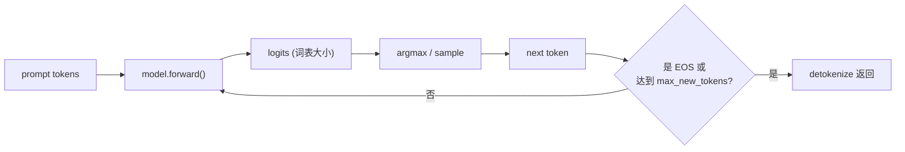
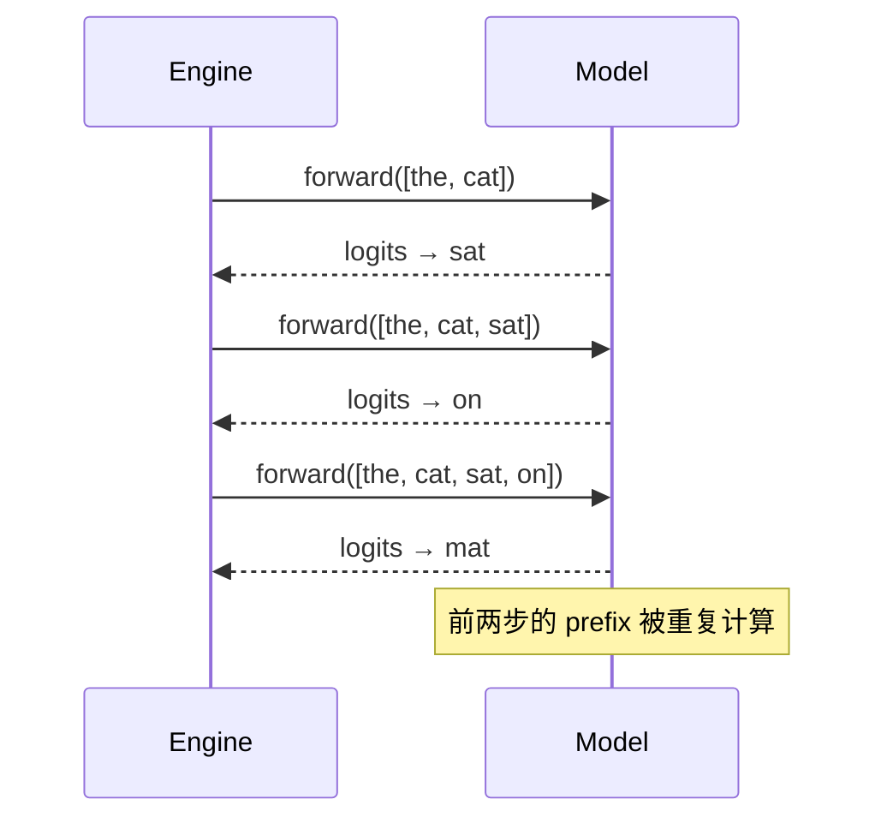

# 01 最小引擎循环：一次只生成一个 token

> **目标**：用不到 150 行 Python，把「推理引擎」最核心的循环跑通。
> 读完你会知道：模型输出的是什么、`argmax` 在干什么、为什么这个最笨的
> 版本明明能出字却很慢，以及后面五章分别要修哪一刀。
>
> **代码**：[`code/mini_engine_v0.py`](./code/mini_engine_v0.py)
> **依赖**：Python 3.10+、`numpy`（不需要 GPU、不需要 transformers）
> **验收**：跑通 3 个请求，能解释 `tokens_seen=25` 是怎么来的。

## 一、直觉：引擎就是一个 `while` 循环

先忘掉 vLLM、PagedAttention、CUDA Graph。一个推理引擎最内核的动作只有
一句话：

> **把当前 token 序列喂给模型，拿到下一个 token，追加到序列末尾，
> 重复到停止。**

画成图：



这就是 v0。没有调度、没有 KV Cache、没有分页；它甚至不区分 prefill 和
decode——每次循环都把整段序列重新算一遍。**先让它正确，再让它快。**

## 二、模型是黑盒：它只给你 logits

对引擎来说，模型可以抽象成一个函数：

```text
logits = model.forward(token_ids)
```

`token_ids` 是当前序列（prompt + 已生成的 token），`logits` 是一个长度
等于词表大小的向量，表示「下一个 token 有多大概率」。

最朴素的选法是 **greedy**：

```text
P(x_t | x_<t) = softmax(logits)
next_token = argmax P = argmax logits
```

因为 softmax 是单调的，`argmax(logits)` 和 `argmax(softmax(logits))`
结果一样，所以贪心解码连 softmax 都不用算。第 6 章会加入 temperature、
top-k、top-p，那时才需要真正算概率。

本系列的 ToyModel 更简单：它是一张 **bigram 转移表**，给定最后一个
token，直接查表得到下一个 token 的 logits。这样你不需要 GPU 就能观察
引擎的调度与缓存行为。

## 三、最小实现：三个类就够了

完整代码在 [`code/mini_engine_v0.py`](./code/mini_engine_v0.py)，核心只有
三个类：

### 3.1 `Request`：一个请求

```python
@dataclass
class Request:
    prompt: list[str]
    max_new_tokens: int = 8
```

真实引擎还会带 `request_id`、`arrival_time`、`stop_strings`、`sampling_params`；
v0 先只保留「输入 + 最多生成多少」。

### 3.2 `ToyModel`：一个可替换的黑盒

```python
class ToyModel:
    def forward(self, token_ids: list[int]) -> np.ndarray:
        self.calls += 1
        self.tokens_seen += len(token_ids)
        last = token_ids[-1]
        logits = self.transition[last].copy()
        return logits
```

注意 `tokens_seen += len(token_ids)`：v0 每次都会把**整段序列**重新
“过模型”。真实模型里，这就是重复计算 prefix 的 K/V；第 2 章会用
KV Cache 消掉它。

### 3.3 `Engine`：循环本体

```python
class Engine:
    def generate(self, request: Request) -> Result:
        token_ids = [TOKEN_TO_ID[t] for t in request.prompt]
        output = []
        for _ in range(request.max_new_tokens):
            logits = self.model.forward(token_ids)
            next_id = int(np.argmax(logits))
            next_token = VOCAB[next_id]
            token_ids.append(next_id)
            output.append(next_token)
            if next_token == EOS:
                break
        return Result(output, ...)
```

把这三段拼起来，就是「推理引擎」的 v0。没有一行 CUDA，也没有一行
调度器，但它已经具备引擎的四个基本动作：

1. **tokenize**：prompt → token ids；
2. **forward**：ids → logits；
3. **sample**：logits → next token；
4. **detokenize**：token ids → 文本（v0 直接返回 token 列表）。

## 四、跑起来

```bash
cd projects/从零实现推理引擎
python3 code/mini_engine_v0.py
```

本机输出（toy 口径，只看趋势）：

```text
[request 1] prompt=['<bos>', 'the', 'cat']
  output=['sat', 'on', 'mat', '.', '<eos>']
  latency=0.046 ms, model_calls=5, tokens_seen=25
[request 2] prompt=['<bos>', 'a', 'dog']
  output=['ran', 'away', '.', '<eos>']
  latency=0.006 ms, model_calls=4, tokens_seen=18
[request 3] prompt=['<bos>', 'the', 'cat', 'sat']
  output=['on', 'mat', '.', '<eos>']
  latency=0.005 ms, model_calls=4, tokens_seen=22

--- summary ---
requests=3 output_tokens=13
wall_time=0.057 ms
throughput=228410.8 tok/s
model_calls=13, tokens_seen=65
```

别被 22 万 tok/s 骗了：ToyModel 只是查表，真实模型慢五到七个数量级。
这里唯一值得看的是 **`tokens_seen` 与 `model_calls`**——它们暴露了 v0
的结构性浪费。

## 五、v0 为什么慢：三笔浪费

### 5.1 浪费一：重复计算 prefix（O(T²)）

请求 1 的 prompt 长度是 3，生成 5 个 token。每次 forward 看到的序列是：

```text
第 1 步： [<bos>, the, cat]                 3 个 token
第 2 步： [<bos>, the, cat, sat]            4 个 token
第 3 步： [<bos>, the, cat, sat, on]        5 个 token
第 4 步： [<bos>, the, cat, sat, on, mat]   6 个 token
第 5 步： [<bos>, the, cat, sat, on, mat, .] 7 个 token
```

总 token 数：

```text
tokens_seen = 3 + 4 + 5 + 6 + 7 = 25
```

一般化，prompt 长度 P、生成 T 个 token：

```text
tokens_seen = Σ_{i=0}^{T-1} (P + i)
            = T·P + T(T-1)/2
            ≈ O(T²)
```

序列越长，重复越多。真实 LLM 里，这些重复计算就是每步重新算一遍
prefix 的 K/V——**第 2 章的 KV Cache 就是把这笔 O(T²) 降到 O(T)。**



### 5.2 浪费二：一次只服务一个请求

v0 的 `for request in requests` 是串行的：请求 1 完全结束后，请求 2 才
开始。GPU 在请求 1 的采样/CPU 簿记期间是空闲的。

真实引擎的做法是 **continuous batching**：把多个请求拼进同一个 batch，
每步只做一次 forward，所有请求共享 GPU。第 3 章实现。

### 5.3 浪费三：没有显存管理

v0 把整段 `token_ids` 存在 Python list 里，没有 KV 显存、没有 block、
没有回收。真实引擎里，KV Cache 会迅速吃满显存，必须回答：

- 每个请求要预留多少 token 的 KV？
- 请求结束时怎么回收？
- 两个请求共享同一段前缀时，能不能复用？

第 4 章的 PagedAttention 与 BlockManager 解决这三个问题。

### 5.4 还有一笔：CPU 与 GPU 的同步

真实模型每步都要做「CPU 发 kernel → GPU 算 → CPU 取回 token」。
GPU 越快，这笔固定开销占比越高。第 7 章的 CUDA Graph 就是把它压掉。

## 六、本章验收

### 必做

1. 跑通 `mini_engine_v0.py`，把 3 个请求的输出抄下来。
2. 手算请求 1 的 `tokens_seen`，确认等于 25。
3. 把 `max_new_tokens` 改成 20，观察 `tokens_seen` 的增长，验证它接近
   二次曲线。

### 选做

1. 把 `Engine.generate` 改成支持 `stop_token` 参数（现在写死 EOS）。
2. 加一个 `temperature` 参数：`logits / temperature` 后再 softmax 采样，
   观察输出变化（第 6 章会系统讲）。
3. 在 `ToyModel.forward` 里加一个 `self.forward_time` 累加，统计「模型
   时间」与「引擎总时间」的比例。

### 面试口播

> 「我先写了一个单请求的 while 循环，它每次把整段序列重新 forward，
> 所以 `tokens_seen` 是 O(T²)。这暴露了三个问题：prefix 重复计算、
> 请求之间串行、KV 没有显存管理。后面分别用 KV Cache、continuous
> batching 和 PagedAttention 解决。」

## 七、下一章：KV Cache

v1 只做一件事：**把已经算过的 K/V 存下来，decode 时不再重算 prefix。**

你会看到：

- prefill 与 decode 的拆分；
- KV Cache 的显存公式；
- 为什么 v1 的输出必须与 v0 完全一致；
- `tokens_seen` 从 25 降到 7 的那一刻。

[下一章：02 KV Cache 与 prefill/decode](./02-kv-cache与prefill-decode.md)
（待写）
