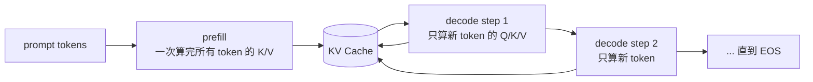

# 02 KV Cache 与 prefill/decode：把 O(T²) 降到 O(T)

> **目标**：给 v0 加上 KV Cache，把「每步重算整段 prefix」改成
> 「prefill 算一次，decode 每步只算 1 个新 token」。
>
> **代码**：[`code/mini_engine_v1.py`](./code/mini_engine_v1.py)
> **依赖**：Python 3.10+、`numpy`
> **验收**：v1 与 v0 输出逐 token 一致，`tokens_seen` 从 25 降到 7，
> `max |logits diff| = 0`。

## 一、直觉：把「读过的书」缓存下来

v0 每生成一个 token，都把整段序列重新过一遍模型。就像每写一个字，
都把前面整本书重读一遍。

v1 只做一件事：**把已经算过的 Key / Value 存下来**。下次注意力需要它们
时直接取，不再重算。这个缓存就叫 **KV Cache**。



两个阶段的分工：

| 阶段 | 输入 | 算什么 | 输出 | 瓶颈 |
|---|---|---|---|---|
| **prefill** | 整段 prompt | 所有 token 的 Q/K/V 与注意力 | 第一个 token 的 logits + KV Cache | 算力（大 GEMM） |
| **decode** | 上一步的 token | 只有新 token 的 Q/K/V | 下一个 token 的 logits | 显存带宽（读 KV + 权重） |

这就是 TTFT 与 TPOT 的物理来源：prefill 决定首字延迟，decode 决定字间
延迟。

## 二、公式：KV Cache 到底省了什么

### 2.1 注意力在算什么

单头注意力：

```text
Q = X · W_q
K = X · W_k
V = X · W_v
Attention(Q, K, V) = softmax(Q·Kᵀ / sqrt(d)) · V
```

其中 `X` 是当前序列的隐藏状态，形状 `[T, d]`。

- **v0**：每生成一个 token，都用长度为 `T` 的 `X` 重算 `Q/K/V`；
- **v1**：`K/V` 已经在 cache 里，decode 只算新 token 的 `q/k/v`，
  然后用 `q_new` 去查全部历史的 `K/V`。

注意：**Q 不需要缓存**。Q 只在当前步用一次；K/V 会被后续所有步反复读，
所以只缓存 K/V。

### 2.2 计算量：从 O(T²) 到 O(T)

prompt 长度 `P`，生成 `T` 个 token：

```text
v0: tokens_seen = Σ_{i=0}^{T-1} (P + i) = T·P + T(T-1)/2 ≈ O(T²)
v1: tokens_seen = P + (T-1) ≈ O(T)
```

为什么 v1 是 `P + T - 1`？prefill 处理 `P` 个 token；之后每生成一个
token（除了最后一个 EOS），decode 只处理 1 个新 token。

本机跑出来：

```text
v0 full  : tokens_seen = 25
v1 cached: tokens_seen = 7
```

### 2.3 KV Cache 的显存公式

```text
KV_bytes = 2 × L × H_kv × d_head × bytes_per_elem × T
```

- `2`：K 和 V 各一份；
- `L`：层数；
- `H_kv`：KV 头数（GQA 下比 Q 头数少）；
- `d_head`：每头维度；
- `bytes_per_elem`：BF16=2、FP8=1、FP16=2；
- `T`：当前序列长度（prompt + 已生成）。

手算一个 7B 模型（Llama-3-8B 量级，L=32、H_kv=8、d_head=128、BF16、
T=4096）：

```text
KV_bytes = 2 × 32 × 8 × 128 × 2 × 4096
         = 536,870,912 B
         ≈ 512 MiB
```

这只是一个请求、4K 上下文。100 个并发就是 50 GiB——**KV Cache 才是
长上下文推理的显存主战场**，不是权重。

## 三、实现：prefill 与 decode 两个入口

完整代码在 [`code/mini_engine_v1.py`](./code/mini_engine_v1.py)。核心是
`HybridModel` 的两个方法：

### 3.1 `prefill`：一次算完 prompt

```python
def prefill(self, token_ids):
    x = self._x(token_ids)          # [P, D]
    k, v = self._kv(x)              # [P, D]
    logits = self.bigram[token_ids[-1]] + 0.1 * self._head(x, k, v)[-1]
    return logits, KVCache(k=k, v=v)
```

`KVCache` 只存两个数组：

```python
@dataclass
class KVCache:
    k: np.ndarray   # [T, D]
    v: np.ndarray   # [T, D]
```

### 3.2 `decode`：每步只算 1 个新 token

```python
def decode(self, token_id, cache):
    pos = len(cache)
    x = self._x([token_id], start=pos)   # [1, D]
    k_new, v_new = self._kv(x)           # [1, D]
    k_all = np.concatenate([cache.k, k_new], axis=0)
    v_all = np.concatenate([cache.v, v_new], axis=0)
    logits = self.bigram[token_id] + 0.1 * self._head(x, k_all, v_all)[-1]
    return logits, KVCache(k=k_all, v=v_all)
```

这里用 `np.concatenate` 是为了让代码最短；真实引擎不会每步重新分配，
而是用预分配的 block + block table（第 4 章的 PagedAttention）。

### 3.3 为什么输出能完全一致

ToyModel 由两部分组成：

```text
logits = bigram[last_token] + 0.1 × attention_logits
```

- bigram 项只依赖最后一个 token，两条路径完全一样；
- attention 项依赖整段 prefix，但 v1 的 cache 已经保存了所有历史
  `K/V`，`q_new` 查到的结果与 v0 重算整段完全等价。

所以：

```text
max |logits diff| = 0.00e+00
outputs identical = True
```

真实模型会有浮点累加顺序差异（通常 1e-6 量级），但 greedy 输出一般
一致；第 8 章会把「逐位一致」单独展开。

## 四、跑起来

```bash
cd projects/从零实现推理引擎
python3 code/mini_engine_v1.py
```

输出：

```text
prompt: ['<bos>', 'the', 'cat']
v0 full  : ['sat', 'on', 'mat', '.', '<eos>']
v1 cached: ['sat', 'on', 'mat', '.', '<eos>']
tokens_seen: full=25, cached=7
KV bytes  : 1792 (toy D=16, 仅作比例演示)
max |logits diff| across steps: 0.00e+00
outputs identical: True
```

`KV bytes=1792` 的来历：`K/V` 各 `7 × 16` 个 float64，即
`2 × 7 × 16 × 8 = 1792 B`。真实模型把 `D` 换成 `L × H_kv × d_head`，
就是上一节的公式。

## 五、本章验收

### 必做

1. 跑通 `mini_engine_v1.py`，确认 `outputs identical: True`。
2. 把 `max_new_tokens` 改成 20，记录 `full` 与 `cached` 的 `tokens_seen`，
   验证前者接近二次、后者线性。
3. 手算 7B 模型在 8K 上下文、BF16 下的 KV 显存，和公式对一遍。

### 选做

1. 把 `HybridModel` 换成 HuggingFace 小模型（Qwen2.5-0.5B），用
   `model(input_ids, use_cache=True)` 的 `past_key_values` 替换这里的
   `KVCache`，观察真实 logits 差异。
2. 给 `KVCache` 加一个 `nbytes` 统计，打印每步的显存增长。
3. 故意不缓存 K/V（每步重算），确认输出一样但 `tokens_seen` 回到 O(T²)。

### 面试口播

> 「v0 每步重算整段 prefix，`tokens_seen` 是 O(T²)。v1 把 K/V 存进
> KV Cache：prefill 算一次，decode 每步只算 1 个新 token，复杂度降到
> O(T)。代价是显存，公式是 `2 × L × H_kv × d_head × bytes × T`；
> 7B 模型 4K 上下文约 512 MiB/请求，所以长上下文推理的瓶颈从算力
> 转到了显存和带宽。」

## 六、下一章：连续批处理

v1 仍然一次只服务一个请求。GPU 在采样和 CPU 簿记时是空闲的。

v2 会把多个请求拼进同一个 batch：

- 请求动态到达、动态结束；
- 每步只做一次 forward，所有请求共享；
- 用 `batch_size` 与 `max_num_batched_tokens` 控制显存与延迟。

下一章：03 连续批处理与调度器（待写，路线图见 [系列目录](./README.md)）
