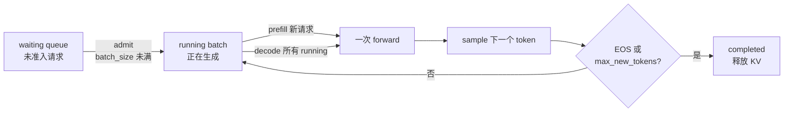

# 03 连续批处理与调度器：让 GPU 不等单个请求

> **目标**：把 v1 的「一次一个请求」改成 v2 的「动态准入 + 每步混批」。
> 读完你会知道 waiting/running 双队列怎么转、prefill 与 decode 怎么在同
> 一个 step 里共存，以及为什么吞吐上去了、TPOT 反而可能变差。
>
> **代码**：[`code/mini_engine_v2.py`](./code/mini_engine_v2.py)
> **依赖**：Python 3.10+、`numpy`；复用第 2 章的 `HybridModel`
> **验收**：同一 workload 下 v2 的 `batch_calls` 明显少于 v1，输出逐 token
> 一致，能解释 speedup 与 TPOT 的 trade-off。

## 一、直觉：从「整批」到「每步重排」

v1 的串行执行像一辆大巴：

```text
请求 0 上车 → 坐满全程 → 下车 → 请求 1 才上车
```

GPU 在「请求 0 采样、CPU 簿记、请求结束」的间隙是空闲的。连续批处理
（continuous batching）把车门改成「每步都开」：

```text
step 0: [req0, req1] 一起 prefill
step 1: [req0, req1] 一起 decode；req2 到达，加入
step 2: [req0, req1, req2] 一起 decode；req0 结束，下车
step 3: [req1, req2] 一起 decode；req3 到达，加入
...
```



一句话：**调度单位从「请求」变成「每一步的 token」**。这就是
iteration-level scheduling 的核心。

## 二、数据结构：两个队列 + 一个 step

v2 的调度器只有三个状态：

| 状态 | 含义 | 操作 |
|---|---|---|
| **waiting** | 已到达、还没准入 | 按到达时间排序；每步尝试准入 |
| **running** | 已准入、正在生成 | 每步 decode；结束后移出 |
| **completed** | 已结束 | 记录指标、释放 KV |

每个 step 做四件事：

1. **准入**：从 waiting 取请求，直到 `running + newly` 达到
   `max_batch_size`；
2. **prefill**：对新准入的请求做一次 forward，得到第一个 token 与
   KV Cache；
3. **decode**：对已在 running、且不是本步新准入的请求，各 decode 一个
   token；
4. **回收**：命中 EOS 或达到 `max_new_tokens` 的请求移到 completed。

注意第 2、3 步可以放在**同一个 batch** 里（vLLM 的 mixed batch），v2
为了代码短，先分成两次 batch 调用；真实引擎会把 prefill 与 decode
拼成一个 forward（第 5 章的 chunked prefill 会进一步处理）。

## 三、关键代码

完整代码在 [`code/mini_engine_v2.py`](./code/mini_engine_v2.py)。

### 3.1 准入：只受 batch_size 限制

```python
newly = []
while waiting and waiting[0].arrival_step <= step \
        and len(running) + len(newly) < max_batch_size:
    req = waiting.pop(0)
    req.start_time = time.perf_counter()
    newly.append(req)
```

真实引擎还会受 **token budget**（`max_num_batched_tokens`）与 **KV
显存**限制；v2 先用 batch_size 把逻辑跑通。

### 3.2 prefill 新请求

```python
results = batch_model.prefill_batch([r.prompt_ids for r in newly])
for req, (logits, cache) in zip(newly, results):
    req.cache = cache
    req.last_token = argmax(logits)
    req.output_ids.append(req.last_token)
    req.first_token_time = time.perf_counter()
    running.append(req)
```

新请求在准入的这一步就采样了第一个 token，所以本步不再重复 decode。

### 3.3 decode 所有 running

```python
decode_reqs = [r for r in running if r not in newly and not r.finished]
results = batch_model.decode_batch(
    [(r.last_token, r.cache) for r in decode_reqs]
)
for req, (logits, cache) in zip(decode_reqs, results):
    req.cache = cache
    req.last_token = argmax(logits)
    req.output_ids.append(req.last_token)
```

真实引擎这里是一次 batched GEMM；v2 的 `BatchModel` 内部仍是循环，
但**每个 batch 只 sleep 一次**，用来模拟「一次 GPU forward 的固定成本」。

### 3.4 回收

```python
for req in list(running):
    if req.finished:
        req.finish_time = time.perf_counter()
        running.remove(req)
        completed.append(req)
```

`finished` 的定义：最后一个 token 是 EOS，或输出长度达到
`max_new_tokens`。真实引擎还要处理 stop strings、abort、超时。

## 四、公式：吞吐、气泡与 speedup

### 4.1 吞吐

```text
throughput = 输出 token 总数 / 墙钟时间
```

v2 的墙钟时间由「batch 步数 × 每步耗时」决定。batch 越大，同样步数
服务的 token 越多，吞吐越高——直到 KV 显存或 TPOT 封顶。

### 4.2 串行气泡

串行执行时，每个请求的墙钟时间近似：

```text
T_serial ≈ Σ_i (prefill_i + decode_steps_i × step_time)
```

请求之间没有重叠，GPU 在采样/簿记时是空闲的。连续批处理把多个请求的
`decode` 叠到同一个 step：

```text
T_batch ≈ steps × step_time
steps ≈ max_i (arrival_i + prefill_i + output_len_i)
```

### 4.3 speedup 的粗略估计

```text
speedup ≈ serial_batch_calls / continuous_batch_calls
```

本机 v2 实测：

```text
serial:             25 batch_calls, 784.1 tok/s
continuous batching: 16 batch_calls, 1231.8 tok/s
speedup: 1.57×
```

`batch_calls` 从 25 降到 16，是因为多个请求的 decode 被合并到同一步；
speedup 不是线性的，因为 prefill 仍然分开、请求到达有先后、batch 大小
受 `max_batch_size=3` 限制。

### 4.4 为什么 TPOT 反而变差

本机：

```text
serial:     avg_TTFT=1.26 ms, avg_TPOT=1.28 ms
continuous: avg_TTFT=1.28 ms, avg_TPOT=1.98 ms
```

因为 v2 的 `BatchModel` 每个 batch 固定 sleep 1ms，batch 越大，单个请求
相邻 token 之间的等待越长。真实 GPU 上 batch 的 step time 会随 batch
**次线性**增长，所以吞吐收益通常大于 TPOT 损失；但这不是免费的：

- **吞吐优先**：增大 batch，tok/s 上升，TPOT 变差；
- **延迟优先**：减小 batch，TPOT 变好，GPU 利用率下降；
- 生产上通常用 `max_num_seqs` / `max_num_batched_tokens` 两个旋钮，
  按 SLO 找平衡点。

## 五、跑起来

```bash
cd projects/从零实现推理引擎
python3 code/mini_engine_v2.py
```

输出（本机 toy 口径）：

```text
=== serial (v1 style) ===
wall_time=31.88 ms, batch_calls=25
output_tokens=25, throughput=784.1 tok/s
avg_TTFT=1.26 ms, avg_TPOT=1.28 ms
  req0: ['sat', 'on', 'mat', '.', '<eos>'] (arrival_step=0)
  req1: ['ran', 'away', '.', '<eos>'] (arrival_step=0)
  ...

=== continuous batching (v2) ===
wall_time=20.30 ms, batch_calls=16
output_tokens=25, throughput=1231.8 tok/s
avg_TTFT=1.28 ms, avg_TPOT=1.98 ms
  ...

outputs identical: True
speedup: 1.57x
```

三个值得注意的点：

1. **输出完全一致**：调度只改变「什么时候算」，不改变「算什么」；
2. **batch_calls 下降**：25→16，说明多个请求的 decode 被合并；
3. **TPOT 上升**：1.28→1.98ms，说明吞吐和延迟不是同一个目标。

## 六、工程取舍

### 6.1 max_batch_size 不是越大越好

- 太小：GPU 吃不饱，气泡多；
- 太大：KV 显存吃紧、TPOT 变差、长请求挤占短请求；
- 真实引擎还会按 `max_num_batched_tokens` 限制「一步最多处理多少
  token」，避免长 prefill 把 decode 饿死。

### 6.2 长 prefill 是下一步的敌人

v2 把 prefill 和 decode 分开做，长 prompt 的 prefill 仍然会占满一步。
真实引擎用 **chunked prefill** 把长 prefill 切成小块，和 decode 混在
同一个 token budget 里——这是第 5 章的内容。

### 6.3 公平性与饥饿

v2 是 FCFS（先到先服务）。如果一直有新请求到达，长请求可能永远排不
到；生产引擎需要优先级、aging、抢占或配额。第 7 章之后可以扩展。

### 6.4 请求结束的回收

v2 只是把请求移出 `running`；真实引擎还要归还 KV block、释放
CUDA Graph 的静态缓冲、更新 prefix cache 的引用计数。第 4 章的
BlockManager 会把这件事做对。

## 七、本章验收

### 必做

1. 跑通 `mini_engine_v2.py`，记录 serial / continuous 的
   `batch_calls`、`throughput`、`avg_TPOT`。
2. 把 `max_batch_size` 改成 1，确认 speedup 回到约 1×。
3. 把 `max_batch_size` 改成 6，观察 throughput 与 TPOT 的反向变化。

### 选做

1. 给调度器加 `max_num_batched_tokens`：每步累计 token 数超过预算就
   停止准入。
2. 把 FCFS 改成「短请求优先」，观察平均 TTFT 与长请求的饥饿。
3. 记录每个 step 的 `batch_size`，画一条「batch size 随时间」的曲线，
   解释为什么它不是一个常数。

### 面试口播

> 「连续批处理把调度单位从请求换成每一步的 token：waiting/running 双
> 队列，每步动态准入，把多个请求的 decode 拼成一个 batch。吞吐提升来
> 自 batch 内 token 数增加，代价是 TPOT 变差与 KV 显存压力。再往下就是
> PagedAttention 解决 KV 碎片、chunked prefill 解决长 prefill 霸占
> GPU。」

## 八、下一章：PagedAttention 与 BlockManager

v2 的 KV Cache 还是「每个请求一个连续数组」。真实引擎里，请求长短不一、
动态到达，连续分配会产生严重碎片。

第 4 章会把 KV 切成固定大小的 **block**，用 **block table** 把逻辑
token 映射到物理 block，实现：

- 按需分配、请求结束回收；
- 前缀共享（两个请求指向同一个物理 block）；
- 显存碎片可控。

下一章：04 PagedAttention 与 BlockManager（待写，路线图见
[系列目录](./README.md)）。
