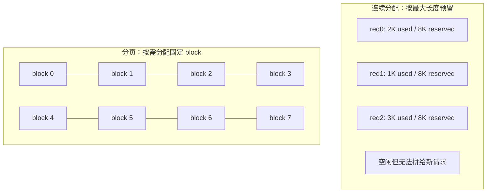

# 04 PagedAttention 与 BlockManager：把 KV 切成块

> **目标**：把 v2 的「每个请求一个连续 KV 数组」改成 v3 的「固定大小
> block + block table」。读完你会知道：连续分配为什么碎片、block table
> 怎么映射、引用计数怎么做前缀共享，以及 block 大小怎么影响浪费。
>
> **代码**：
> [`code/block_manager.py`](./code/block_manager.py)、
> [`code/mini_engine_v3.py`](./code/mini_engine_v3.py)
> **依赖**：Python 3.10+、`numpy`
> **验收**：v3 与 v1 输出一致；两个请求 `fork` 后 block 引用计数 +1；
> 请求结束 block 全部归还；block 用尽时抛 `MemoryError`。

## 一、问题：连续 KV 为什么会碎片

v1/v2 给每个请求分配一个连续 KV 数组。真实请求的长度是未知的：

- 你不知道用户会输入多长、会生成多少 token；
- 如果按 `max_model_len` 预留，短请求会浪费大量显存（**内部碎片**）；
- 如果按实际长度动态扩容，请求之间会留下大小不一的空洞
  （**外部碎片**），新请求可能明明总显存够、却找不到连续空间。



PagedAttention 的答案借自操作系统：**把 KV 切成固定大小的 block，
逻辑上连续，物理上可以分散**。

## 二、直觉：虚拟内存的翻版

| OS 虚拟内存 | PagedAttention |
|---|---|
| 虚拟页 | 逻辑 block（第 0、1、2… 个 block） |
| 物理页帧 | 物理 block（显存里真实的一块） |
| 页表 | **block table**（逻辑块 → 物理块） |
| 缺页 | 新 token 需要新 block 时分配 |
| 进程退出回收页 | 请求结束、引用计数归零后回收 block |

一个请求的 block table 可能长这样：

```text
逻辑 block:   0     1     2
物理 block:   7  →  2  →  9
```

token 0-3 在物理 block 7，token 4-7 在物理 block 2，token 8-11 在
物理 block 9。注意力计算时，按 block table 去这三块里读 K/V 即可，
**不需要它们在显存里连续**。

## 三、公式：block 数、浪费与共享

设 block 大小为 `B` 个 token，序列长度为 `T`：

```text
每个请求的 block 数 = ceil(T / B)
内部碎片 = B - (T mod B)   （最后一个 block 没用满的部分）
```

- `B` 越大：block table 越短、管理开销越小，但最后一个 block 浪费越多；
- `B` 越小：浪费越小，但 block table 越长、分配/寻址开销越大。

常见取值：vLLM 默认 **16**，某些场景 32/64；本系列用 4 让过程可见。

KV 显存本身仍是第 2 章的公式：

```text
KV_bytes = 2 × L × H_kv × d_head × bytes_per_elem × T
```

分页不改变 KV 总量，只改变**怎么放**；它省的是碎片和预留，不是 KV
本身。

前缀共享时，如果两个请求共享 `S` 个完整 block：

```text
节省的物理 block ≈ S × (引用数 - 1)
```

引用计数 `ref_count[block]` 记录有多少请求指向它；最后一个引用释放时，
block 才回到 free list。

## 四、实现：三个对象

完整代码在 [`code/block_manager.py`](./code/block_manager.py)。

### 4.1 `Block`：一块固定大小的 K/V

```python
@dataclass
class Block:
    k: np.ndarray   # [block_size, dim]
    v: np.ndarray   # [block_size, dim]
    length: int = 0 # 已写入多少 token
```

真实引擎里 `k/v` 是显存指针；这里用 numpy 数组模拟。

### 4.2 `BlockManager`：分配、回收、fork

```python
class BlockManager:
    def allocate(self, n=1):   # 从 free list 取 n 块，ref_count=1
    def free(self, block_ids): # ref_count-1；归零才放回 free list
    def fork(self, block_ids): # ref_count+1，共享前缀
```

关键不变量：

- `ref_count[bid] > 0` 的 block 不在 `free_blocks` 里；
- `free` 只在引用计数归零时清空数据并归还；
- `allocate` 时如果 free list 不够，抛 `MemoryError`——真实引擎此时
  会触发抢占/驱逐，而不是直接崩。

### 4.3 `PagedKVCache`：一个请求的 block table

```python
class PagedKVCache:
    def append(self, k_new, v_new):
        for each token:
            if self.length % block_size == 0:
                self.block_table.append(manager.allocate(1)[0])
            write token into last block
            self.length += 1

    def gather(self):
        # 把分散的 block 拼成连续 K/V，供 toy attention 使用
```

`gather` 只是为了 numpy 版 attention 能算；真实 PagedAttention kernel
会按 block table 直接读显存，不会真的复制。

### 4.4 `fork`：完整 block 共享，尾部 block 复制

```python
def fork(self):
    child = PagedKVCache(manager)
    for bid in self.block_table:
        if block.length == block_size:
            manager.fork([bid])       # 完整块：共享，ref_count+1
            child.block_table.append(bid)
        else:
            new_bid = manager.allocate(1)[0]  # 尾部未满：复制
            copy block data
            child.block_table.append(new_bid)
    return child
```

为什么尾部要复制？如果两个请求共享一个没填满的 block，其中一个继续
append 会写坏另一个的数据。完整 block 不会再被写，才能安全共享。
这就是 PagedAttention 的 **copy-on-write** 简化版。

### 4.5 `PagedAttentionModel`：把 cache 接进 attention

```python
def prefill(self, token_ids):
    x = model._x(token_ids)
    k, v = model._kv(x)
    cache = PagedKVCache(manager)
    cache.append(k, v)
    k_all, v_all = cache.gather()
    logits = bigram[last] + 0.1 * attention(x, k_all, v_all)[-1]
    return logits, cache
```

decode 同理：只算新 token 的 k/v，append 进 cache，再 gather 历史。

## 五、跑起来

```bash
cd projects/从零实现推理引擎
python3 code/mini_engine_v3.py
```

输出：

```text
=== 1) 单请求：v1 连续 KV vs v3 paged KV ===
v1: ['sat', 'on', 'mat', '.', '<eos>']
v3: ['sat', 'on', 'mat', '.', '<eos>']
identical: True
v3 block_table: [0, 1] length: 7
manager: used=2/32, free=30, peak=2
after free: used=0/32, free=32, peak=2

=== 2) 前缀共享：fork 完整 block，引用计数 +1 ===
prompt length: 8
cache_a blocks: [0, 1]
cache_b blocks: [0, 1]
ref_count after fork: {0: 2, 1: 2}
after decode:
  cache_a blocks: [0, 1, 2]
  cache_b blocks: [0, 1, 3]
manager: used=4/32, free=28, peak=4
after free cache_a: {0: 1, 1: 1, 3: 1}
after free both: used=0/32, free=32, peak=4

=== 3) block 用尽：显存不足时显式报错 ===
allocated: [0, 1, 2, 3] stats: used=4/4, free=0, peak=4
expected MemoryError: KV pool exhausted: need 1, free 0
after free: used=0/4, free=4, peak=4
```

三个结论：

1. **分页不改变输出**：v1 与 v3 逐 token 一致；
2. **共享是真的省**：两个请求各 8 token 前缀，fork 后只占 2 个物理
   block（而不是 4 个），引用计数为 2；
3. **回收是干净的**：两个请求都结束后，`free=32`，没有泄漏。

## 六、工程取舍

### 6.1 block 大小

- `B=16`：block table 短、寻址开销小，但短请求可能浪费最多 15 个
  token 的 KV；
- `B=4`：浪费小、教学直观，但 block table 长、管理开销大；
- 真实引擎常按模型/硬件调，vLLM 默认 16，不是金科玉律。

### 6.2 block table 本身也有成本

```text
block_table_bytes ≈ ceil(T / B) × 4   （int32）
```

1M token、B=16 → 62,500 个 block → 250KB/请求。和 KV 本身比很小，
但高并发下要算进去。

### 6.3 共享与驱逐的冲突

前缀共享让多个请求指向同一个 block；驱逐时必须看引用计数，不能直接
把「看起来冷」的 block 回收。第 5 章的 RadixCache 会把「前缀树 + 引用
计数 + LRU」组合起来。

### 6.4 OOM 不是终点

本 demo 在 block 用尽时抛 `MemoryError`。真实引擎的选择是：

- **抢占**：暂停/回滚低优先级请求，腾出 block；
- **驱逐**：把冷 prefix 的 block 换到 CPU/SSD；
- **拒绝**：直接返回 429/排队。

这三种策略对应第 5 章与第 7 章。

## 七、接到 v2 调度器

v3 的 `PagedAttentionModel` 可以直接替换 v2 的 `BatchModel`：

```python
# 伪代码
cache = paged_model.prefill(prompt)
...
logits, cache = paged_model.decode(token, cache)
...
cache.free()   # 请求结束时归还 block
```

需要改的只有三处：

1. `Request.cache` 的类型从 `KVCache` 换成 `PagedKVCache`；
2. 请求完成时调用 `cache.free()`；
3. 调度器准入时检查 `manager.free_blocks` 是否够，不够就排队/抢占。

这就是 vLLM `BlockManager` 与 `Scheduler` 的接缝。

## 八、本章验收

### 必做

1. 跑通 `mini_engine_v3.py`，确认 `identical: True`。
2. 把 `block_size` 改成 2 和 8，记录 block_table 长度、峰值 block 数、
   最后一个 block 的浪费。
3. 把 `num_blocks` 改成 2，构造两个请求，观察 `MemoryError`，并解释
   真实引擎此时会做什么。

### 选做

1. 实现 `fork` 在「非完整尾块」上的 copy-on-write：构造一个 6 token
   的 prompt，fork 后分别 append，确认两个请求的数据不互相污染。
2. 给 `BlockManager` 加一个 `can_allocate(n)`，在调度器准入前检查。
3. 把 `gather` 换成「按 block table 逐块算 attention」的循环，体会
   真实 PagedAttention kernel 为什么不需要连续 K/V。

### 面试口播

> 「连续 KV 按最大长度预留会内部碎片，动态扩容会外部碎片。PagedAttention
> 把 KV 切成固定 block，每个请求维护 block table，逻辑连续、物理分散。
> 引用计数让多个请求共享前缀，完整 block 共享、尾部 copy-on-write。
> 代价是 block table 与寻址开销；block 大小是浪费与管理成本的权衡。」

## 九、下一章：前缀缓存与 RadixCache

v3 的 `fork` 是手动共享；第 5 章会把「哪些前缀值得共享」自动化：

- 用 token 序列建一棵 radix tree；
- 命中前缀时直接复用 block；
- 没命中时插入新节点；
- 显存不够时按 LRU/引用计数驱逐。

下一章：05 前缀缓存与 RadixCache（待写，路线图见
[系列目录](./README.md)）。
