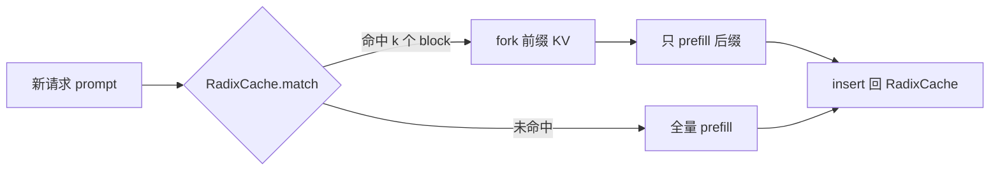
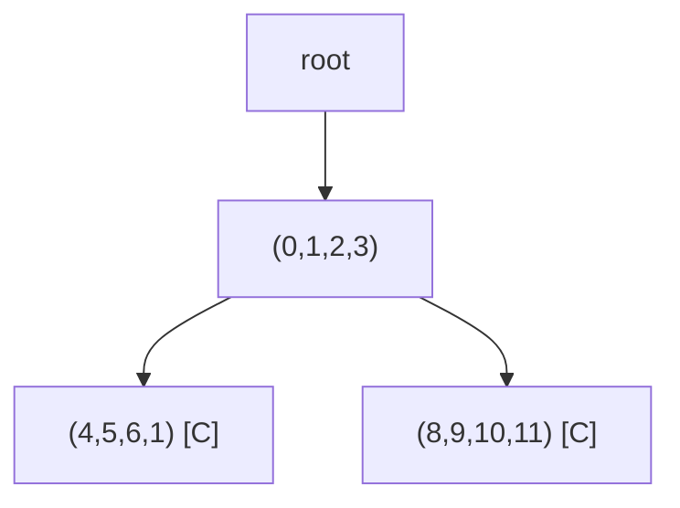

# 05 前缀缓存与 RadixCache：让第二次请求少算一半

> **目标**：把 v3 的手动 `fork` 自动化成 RadixCache 的 match / insert /
> evict。读完你会知道：前缀缓存为什么能省 prefill、block 级 radix tree
> 怎么走、分叉前缀怎么截取、LRU 驱逐与引用计数怎么配合。
>
> **代码**：
> [`code/prefix_cache.py`](./code/prefix_cache.py)、
> [`code/mini_engine_v4.py`](./code/mini_engine_v4.py)
> **依赖**：Python 3.10+、`numpy`；复用第 4 章的 BlockManager
> **验收**：同一 prompt 第二次 `matched=8, prefill_tokens=0`；共享
> 4 token 的分叉请求 `matched=4, prefill_tokens=4`；evict 后 cached
> block 减少、请求输出不变。

## 一、直觉：前缀是「已经算过的答案」

多轮对话、agent、few-shot、系统提示，都会反复出现同一段前缀：

```text
[系统提示 800 token] + [用户第 1 轮] + ...
[系统提示 800 token] + [用户第 2 轮] + ...
```

如果没有前缀缓存，每个请求都要把 800 token 的 prefill 重算一遍。
前缀缓存把「这段前缀的 KV block」存下来，下一个请求命中后直接复用：



一句话：**前缀缓存把「重复的 prefill」变成「一次查表 + 一次 fork」。**

## 二、为什么是 RadixTree，而不是哈希表

最简单的缓存是「整段 prompt 的哈希 → KV」。它只能命中**完全相同**的
prompt；如果两个请求只有前 800 token 相同、后面不同，就命不中。

RadixTree 把 token 序列按前缀组织成一棵树：



- 节点存一段 token（本系列按 block 存，4 个 token 一段）；
- 从 root 往下走，就是「共同前缀」；
- `[C]` 表示这个节点挂了一份 cached KV；
- 分叉请求走到 `(0,1,2,3)` 就分叉，仍然能复用这一段的 KV。

真实 SGLang 的 RadixCache 是 token 粒度、支持节点 split；本系列用
block 粒度，保留「共同前缀 + 分叉 + 驱逐」三个核心机制。

## 三、公式：命中多少、省多少

设 block 大小 `B`，命中 `m` 个完整 block：

```text
matched_tokens = m × B
prefill_tokens = len(prompt) - matched_tokens
saved_prefill_ratio = matched_tokens / len(prompt)
```

TTFT 近似：

```text
TTFT ≈ 排队时间 + prefill_tokens × 每 token prefill 成本 + 首 token 采样
```

所以前缀命中对 TTFT 的收益是**线性**的：命中 800 token，就少算 800
token 的 prefill。对 decode/TPOT 没有直接收益，但省下的算力可以换更大
batch。

缓存命中率：

```text
hit_rate = hits / (hits + misses)
```

注意：**命中率高不等于收益高**。如果命中的都是很短的前缀，省下的
prefill 可能还不如查树/ fork 的开销。

## 四、实现：三个操作

完整代码在 [`code/prefix_cache.py`](./code/prefix_cache.py)。

### 4.1 `match`：走树，找最长 cached 前缀

```python
def match(self, token_ids):
    keys = self._block_keys(token_ids)
    node = self.root
    best_cache, best_blocks = None, 0
    for i, key in enumerate(keys):
        if key not in node.children:
            break
        node = node.children[key]
        cached = self._find_cached(node)   # 自身或子树里的 cache
        if cached is not None:
            best_cache, best_blocks = cached, i + 1
    if best_cache is None:
        return 0, None
    return best_blocks * B, best_cache.cache.fork_prefix(best_blocks)
```

这里有一个容易踩的坑：**cache 通常挂在最深的后继节点上**。分叉请求
走到 `(0,1,2,3)` 时，这个节点自己可能没有 cache，但它的子树里有。
所以 `_find_cached` 要找子树；找到后用 `fork_prefix(best_blocks)`
只截取祖先那一段，而不是把整条后继 cache 都拿过来。

### 4.2 `insert`：把请求 cache fork 一份挂上去

```python
def insert(self, token_ids, cache):
    node = walk_or_create(...)
    if node.cache is None:
        node.cache = cache.fork()   # 关键：fork，不是直接存
```

为什么必须 `fork`？请求结束后会 `cache.free()`；如果树直接存请求的
cache，block 会被释放，树就指向悬空数据。`fork` 增加引用计数，树持有
自己的一份引用。

### 4.3 `evict`：LRU 释放 cached block

```python
def evict(self, num_blocks):
    nodes = [n for n in all_nodes if n.cache and n.pinned == 0]
    nodes.sort(key=lambda n: n.last_access)
    for n in nodes:
        freed += len(n.cache.block_table)
        n.cache.free()
        n.cache = None
```

真实引擎还要处理：

- **pinned**：正在被请求使用的 cache 不能驱逐；
- **引用计数**：block 可能被多个请求共享，只有归零才能回收；
- **驱逐粒度**：按 block、按节点、还是按整条前缀；
- **多租户隔离**：不能把 A 租户的 KV 命中给 B 租户（安全侧信道）。

## 五、跑起来

```bash
cd projects/从零实现推理引擎
python3 code/mini_engine_v4.py
```

输出：

```text
=== 1) 第一次请求：prefix 未命中 ===
output=['cat', 'sat', 'on', 'mat', '.', '<eos>'], matched=0, prefill_tokens=8

=== 2) 相同 prompt 第二次：全命中 ===
output=['cat', 'sat', 'on', 'mat', '.', '<eos>'], matched=8, prefill_tokens=0
outputs identical: True

=== 3) 共享 4 token、后 4 token 分叉：部分命中 ===
output=['.', '<eos>'], matched=4, prefill_tokens=4

=== 4) RadixTree 与显存状态 ===
radix tree:
  (0, 1, 2, 3) [-]
    (4, 5, 6, 1) [C]
    (8, 9, 10, 11) [C]
hits=2, misses=1, cached_blocks=4, evictions=0
manager: used=3/64, free=61, peak=4

=== 5) LRU evict 2 个 block ===
freed=2, hits=2, misses=1, cached_blocks=2, evictions=1, manager=used=2/64, free=62
```

三个结论：

1. **相同 prompt 第二次 prefill 0 token**，输出与第一次完全一致；
2. **分叉请求只算后缀 4 token**，前面 4 token 直接复用；
3. **evict 后 cached block 减半**，但已经完成的请求输出不受影响。

## 六、工程取舍

### 6.1 block 粒度 vs token 粒度

- block 粒度：实现简单、与 PagedAttention 对齐；但只能命中完整 block，
  尾部不足一个 block 的前缀会浪费。
- token 粒度：命中更细，但需要节点 split、page 映射与更复杂的驱逐；
  SGLang 的 RadixCache 走这条路。

### 6.2 缓存污染

如果每个请求都插入，RadixTree 会迅速膨胀，把真正高频的前缀挤掉。
生产上常见策略：

- 只缓存出现次数 ≥ 2 的前缀；
- 按租户/模型分树；
- 给节点加权重（命中收益 × 频率），而不是纯 LRU；
- 限制树的最大 block 数，定期 compact。

### 6.3 与调度器的接缝

v4 是「请求来了先查树」；真实引擎还要在调度器准入时检查：

```text
needed_blocks = ceil((prompt_len - matched_len) / B)
if block_manager.free_blocks < needed_blocks:
    排队 / 抢占 / 驱逐
```

否则会出现「前缀命中了，但后缀没有 block 可写」的尴尬。

### 6.4 安全与多租户

前缀缓存天然是跨请求共享的。多租户下必须做隔离：

- 按 tenant/model 分树；
- 或在 block key 里混入 `cache_salt`；
- 否则攻击者可以通过命中率/延迟推断别人的 prompt。

## 七、本章验收

### 必做

1. 跑通 `mini_engine_v4.py`，记录 A/B/C 的 `matched` 与
   `prefill_tokens`。
2. 把 `block_size` 改成 2 和 8，观察 `matched` 与树结构的变化。
3. 加一个请求 D：共享 8 token 前缀、后面接不同后缀，确认
   `matched=8, prefill_tokens=len(suffix)`。

### 选做

1. 给 `RadixNode` 加 `pinned`：请求使用期间 pin 住，`evict` 跳过；
   请求结束 `unpin`。
2. 实现「只缓存出现两次以上的前缀」：第一次 insert 只记计数，第二次
   才挂 cache。
3. 把 `fork_prefix` 换成真正的 token 粒度 split，体验 RadixCache 的
   节点切分。

### 面试口播

> 「前缀缓存把重复的 prefill 变成一次查树 + 一次 fork。RadixTree 按
> 共同前缀组织，命中时用 fork_prefix 截出前缀 block；insert 要 fork
> 一份给树，避免请求释放后悬空；evict 按 LRU + 引用计数，正在用的
> 节点不能驱逐。收益是 TTFT 线性下降，代价是树维护、缓存污染与多租户
> 隔离。」

## 八、下一章：采样与停止条件

v4 的 `argmax` 只是 greedy。真实引擎还要支持：

- temperature、top-k、top-p；
- repetition penalty、frequency/presence penalty；
- stop strings、max_tokens、abort；
- 结构化输出（JSON/grammar）的 mask。

下一章：06 采样与停止条件（待写，路线图见
[系列目录](./README.md)）。
