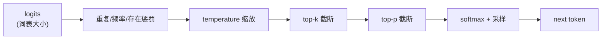

# 06 采样与停止条件：从 logits 到下一个 token

> **目标**：把 v1–v4 里写死的 `argmax` 换成可配置采样：temperature、
> top-k、top-p、repetition/frequency/presence penalty，以及 EOS /
> max_tokens / stop strings 三种停止条件。
>
> **代码**：
> [`code/sampling.py`](./code/sampling.py)、
> [`code/mini_engine_v5.py`](./code/mini_engine_v5.py)
> **依赖**：Python 3.10+、`numpy`
> **验收**：能解释 T=0.5/1.0/2.0 的分布差异；top-k=2 与 top-p=0.8
> 保留的候选不同；repetition penalty 能把 argmax 从重复 token 挪走；
> stop string 能在正确位置截断。

## 一、直觉：采样是一条流水线

模型每步只给你一个 logits 向量。要把它变成「下一个 token」，中间有一串
可选的加工步骤：



- **greedy**：跳过所有加工，直接 `argmax`；
- **temperature**：控制分布的「尖锐/平坦」；
- **top-k / top-p**：把低概率候选直接砍掉，避免采样到离谱 token；
- **penalty**：降低已出现 token 的分数，缓解复读；
- **stop**：决定什么时候停。

## 二、公式

### 2.1 softmax 与 temperature

```text
p_i = exp(z_i / T) / Σ_j exp(z_j / T)
```

- `T → 0`：分布越来越尖，极限就是 greedy；
- `T = 1`：原始分布；
- `T > 1`：分布更平，输出更随机。

本机例子（logits = `[2.0, 1.5, 1.0, 0.5, 0.0]`）：

```text
T=0.5  A:0.636  B:0.234  C:0.086  D:0.032  E:0.012
T=1.0  A:0.429  B:0.260  C:0.158  D:0.096  E:0.058
T=2.0  A:0.310  B:0.241  C:0.188  D:0.146  E:0.114
```

### 2.2 top-k

只保留 logits 最大的 `k` 个 token，其余置为 `-inf`，再 softmax：

```text
keep = top_k(logits, k)
p_i = softmax(keep)_i
```

`k=0` 表示不限制；`k=1` 等价 greedy。

### 2.3 top-p (nucleus sampling)

按概率从大到小排序，保留累计概率首次达到 `p` 的最小集合：

```text
sorted probs: p_(1) ≥ p_(2) ≥ ...
cutoff = min{ m : Σ_{i=1}^{m} p_(i) ≥ p }
```

本机 `p=0.8`、`T=1.0`：

```text
A 0.429 + B 0.260 = 0.689 < 0.8
A + B + C = 0.847 ≥ 0.8
=> 保留 A/B/C
```

top-p 比 top-k 更自适应：分布尖时只留一两个，分布平时留更多。

### 2.4 repetition / frequency / presence penalty

重复惩罚（对已生成 token）：

```text
if z_i > 0: z_i = z_i / penalty
else:      z_i = z_i * penalty
```

频率/存在惩罚：

```text
z_i -= frequency_penalty × count_i
z_i -= presence_penalty × 1[count_i > 0]
```

本机例子：

```text
原始 logits:              [3.0, 2.9, 1.0] -> argmax 0
repetition=2.0:           [1.5, 2.9, 1.0] -> argmax 1
frequency/presence=0.5:   [1.0, 2.9, 1.0] -> argmax 1
```

### 2.5 停止条件

```text
stop = (token == EOS) or (generated >= max_new_tokens) or text.endswith(stop_string)
```

注意：stop string 必须在**解码后的文本**上匹配，不能只在 token id 上
匹配；一个 stop string 可能跨多个 token。

## 三、实现

完整代码在 [`code/sampling.py`](./code/sampling.py)。

### 3.1 `SamplingParams`

```python
@dataclass
class SamplingParams:
    temperature: float = 1.0
    top_k: int = 0
    top_p: float = 1.0
    repetition_penalty: float = 1.0
    frequency_penalty: float = 0.0
    presence_penalty: float = 0.0
    seed: int | None = None
```

真实引擎还会带 `stop`、`max_tokens`、`logprobs`、`n`、`best_of`、
`grammar` 等；v5 只保留最核心的六个。

### 3.2 `sample_token`

```python
def sample_token(logits, params, generated_ids, rng):
    logits = apply_repetition_penalty(...)
    logits = apply_frequency_presence_penalty(...)
    if params.temperature == 0:
        return argmax(logits)
    logits = top_k_filter(logits, params.top_k)
    logits = top_p_filter(logits, params.top_p)
    probs = softmax(logits, params.temperature)
    return rng.choice(len(probs), p=probs)
```

顺序很重要：**先惩罚，再 temperature，再 top-k/top-p，最后 softmax**。
top-p 需要概率，所以在它之前要先对当前 logits 做一次 softmax；实现里
`top_p_filter` 内部自己算，不依赖外部温度。

### 3.3 `StoppingCriteria`

```python
@dataclass
class StoppingCriteria:
    eos_token_id: int | None
    max_new_tokens: int
    stop_strings: list[str]

    def should_stop(self, new_token_id, text, generated):
        ...
```

引擎每步只做一次检查：

```python
next_id = sample_token(logits, params, generated, rng)
text += tokenizer.decode([next_id])
if stop.should_stop(next_id, text, len(generated)):
    break
logits, cache = model.decode(next_id, cache)
```

## 四、跑起来

```bash
cd projects/从零实现推理引擎
python3 code/mini_engine_v5.py
```

输出：

```text
=== 1) temperature 改变分布 ===
T=0.5  A:0.636  B:0.234  C:0.086  D:0.032  E:0.012
T=1.0  A:0.429  B:0.260  C:0.158  D:0.096  E:0.058
T=2.0  A:0.310  B:0.241  C:0.188  D:0.146  E:0.114
T→0 等价 greedy：A

=== 2) top-k / top-p 截断候选 ===
top_k=2 保留： ['A', 'B']
top_p=0.8 保留： ['A', 'B', 'C']

=== 3) 重复惩罚改变 argmax ===
原始 logits: [3.  2.9 1. ] -> argmax 0
repetition=2.0: [1.5 2.9 1. ] -> argmax 1
frequency/presence=0.5: [1.  2.9 1. ] -> argmax 1

=== 4) stop strings / EOS / max_new_tokens ===
step 3: stop at '</s>', text='Hello world</s>'
kept tokens: ['Hello', ' world', '</s>']
truncated at stop string: True

=== 5) 温度对采样分布的影响（20 次） ===
T=0.5: {'B': 8, 'A': 10, 'D': 1, 'C': 1}
T=1.5: {'C': 5, 'B': 5, 'D': 4, 'A': 4, 'E': 2}
```

## 五、工程取舍

### 5.1 greedy vs sampling

- **greedy**：确定性、可复现、适合代码/数学/结构化输出；但容易复读、
  缺少多样性；
- **sampling**：多样、适合创作/对话；但同样 prompt 可能不同答案，
  评测与回归更难。

### 5.2 temperature 不是「越高越聪明」

`T` 只改变分布的平坦程度，不改变模型知识。`T` 太高会采样到低概率
垃圾 token；`T` 太低会退化成 greedy。生产上常按任务给不同默认值。

### 5.3 top-k vs top-p

- top-k 固定候选数，简单、可预测；但分布尖时保留太多垃圾，分布平时
  又砍掉太多；
- top-p 自适应候选数，通常效果更好；但需要排序，成本略高；
- 两者可以叠加：先 top-k 再 top-p。

### 5.4 惩罚的副作用

- repetition penalty 太强会让模型「不敢重复必要的词」（如代码变量名、
  专有名词）；
- frequency/presence penalty 会改变 token 的边际收益，可能破坏格式；
- 生产上通常按任务小步调，不要在代码/JSON 场景开大。

### 5.5 stop strings 的坑

- 必须解码后匹配；多 token 的 stop string 需要维护一个滑动窗口；
- 如果 stop string 是 `"\n\n"`，可能在不同 tokenizer 下切分不同；
- 截断时要决定「保留 stop string 还是删掉」，API 语义要一致。

### 5.6 结构化输出

JSON/grammar 约束的本质是**在采样前给 logits 加 mask**：

```text
for token in vocab:
    if not grammar.allows(token):
        logits[token] = -inf
```

这样采样只会在合法 token 里进行。第 8 章之后的扩展可以接
XGrammar/Outlines；v5 只留接口。

### 5.7 可复现性

- 给每个请求独立的 `np.random.Generator(seed)`；
- 不要在多请求之间共享 RNG，否则 batch 组成会改变采样序列；
- GPU 上还要固定 kernel/归约顺序，才能做到逐位可复现。

## 六、接到引擎

把 v5 的 `sample_token` 接到 v1–v4 的 decode 循环里，只需要替换一行：

```python
# 旧：next_id = int(np.argmax(logits))
next_id = sample_token(logits, params, generated_ids, rng)
```

然后每步检查 `StoppingCriteria`。真实引擎还要处理：

- **batch sampling**：一个 batch 里每个请求有自己的 params/RNG；
- **stop 检查的批量化**：不能每个请求都同步等 CPU；
- **logprobs**：返回采样 token 的 logprob，供 RL/评测使用；
- **abort**：客户端断开时立即停止并释放 KV。

## 七、本章验收

### 必做

1. 跑通 `mini_engine_v5.py`，记录 T=0.5/1.0/2.0 的分布。
2. 手算 top_p=0.8 为什么保留 A/B/C，而不是只保留 A/B。
3. 把 repetition penalty 改成 1.5，观察 argmax 是否变化。
4. 把 `max_new_tokens` 改成 2，确认 stop 在长度上限触发。

### 选做

1. 给 `SamplingParams` 加 `stop` 字段，并接到 `StoppingCriteria`。
2. 实现 `logprobs`：返回采样 token 的 `log p`。
3. 写一个 JSON grammar mask 的 toy 版：只允许 `{`、`"`、字母、`}`。
4. 用固定 seed 跑两次，确认采样序列完全一致；换 seed 确认不同。

### 面试口播

> 「采样是一条流水线：先做重复/频率惩罚，再按 temperature 缩放，然后
> top-k/top-p 截断候选，最后 softmax 采样。temperature 控制分布尖锐度，
> top-p 按累计概率自适应保留候选。停止条件有 EOS、max_tokens、stop
> strings 三种；stop string 必须在解码文本上匹配。结构化输出本质是
> 采样前给 logits 加 grammar mask。」

## 八、下一章：CUDA Graph 与性能优化

v5 还是 CPU/NumPy 的 toy。第 7 章会把视角切到真实 GPU：

- 为什么 decode 每步的 kernel launch 会变成瓶颈；
- CUDA Graph 怎么把「多次 launch」变成「一次 replay」；
- 动态 shape / batch 变化时 graph 为什么要重捕；
- 用一个小 benchmark 量出 launch overhead 占比。

下一章：07 CUDA Graph 与性能优化（待写，路线图见
[系列目录](./README.md)）。
