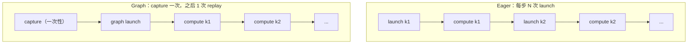

# 07 CUDA Graph 与性能优化：把多次 launch 压成一次 replay

> **目标**：讲清 decode 每步的 CPU launch overhead 为什么会变成瓶颈，
> CUDA Graph 怎么把「N 次 kernel launch」变成「一次 graph launch」，
> 以及 capture 成本、动态 shape、side effect 带来的边界。
>
> **代码**：[`code/cuda_graph_sim.py`](./code/cuda_graph_sim.py)
> **依赖**：Python 3.10+（模拟器不需要 GPU；真实 capture 需要 CUDA）
> **验收**：能算出 break-even steps；解释为什么 1 步时 graph 反而更慢、
> 256 步时快 1.8×；能说出 CUDA Graph 的四个 capture 约束。

## 一、直觉：GPU 算得快，CPU 发得慢

decode 每步要跑很多小 kernel：RMSNorm、QKV projection、attention、
MLP、sampling……每个 kernel 的 CPU 侧都要做一次 launch：

```text
CPU: 发 k1 → 发 k2 → 发 k3 → ... → 发 kN
GPU:      算 k1 → 算 k2 → 算 k3 → ... → 算 kN
```

如果每个 kernel 的 compute 只有几十微秒，而 launch 要几微秒到十几微秒，
CPU 就会成为瓶颈。GPU 在等 CPU 发下一条指令，而不是在算。

CUDA Graph 的思路：**先把整段 kernel 序列 capture 成一张图，之后每次
只发一次 `graph.replay()`**。



## 二、公式：省多少、什么时候回本

设每步 `N` 个 kernel：

```text
T_eager_step = N × (t_launch + t_compute)
T_graph_step = t_launch + N × t_compute
单步节省     = (N - 1) × t_launch
```

capture 有一次性成本 `t_capture`，所以：

```text
break_even_steps = t_capture / ((N - 1) × t_launch)
speedup(steps)   = steps × T_eager_step / (t_capture + steps × T_graph_step)
```

本机模拟参数：`N=20`、`t_launch=0.05ms`、`t_compute=0.05ms`、
`t_capture=5ms`：

```text
单步节省 = 19 × 0.05 = 0.95ms
break_even = 5 / 0.95 ≈ 5.3 steps
```

所以：

- 只生成 1 步：capture 的 5ms 还没摊回来，graph 反而慢；
- 生成 4 步：接近打平；
- 生成 16/64/256 步：graph 开始明显赢。

## 三、实现：CPU 模拟器

完整代码在 [`code/cuda_graph_sim.py`](./code/cuda_graph_sim.py)。

### 3.1 `EagerRunner`：每个 kernel 一次 launch

```python
def step(self):
    for kernel in self.kernels:
        sleep(launch_ms)   # CPU 发 kernel
        sleep(kernel.compute_ms)  # GPU 算
```

### 3.2 `GraphRunner`：capture 一次，replay 多次

```python
def capture(self):
    sleep(capture_ms)
    self.captured = True

def step(self):
    if not self.captured:
        self.capture()
    sleep(launch_ms)       # 一次 graph launch
    for kernel in self.kernels:
        sleep(kernel.compute_ms)  # 图内 kernel 仍要算
```

注意：graph 省的是 **CPU launch**，不是 GPU compute。图内 kernel 的
计算时间一点没少；如果 kernel 本身是 compute-bound，graph 收益有限。

### 3.3 benchmark

```python
for steps in [1, 4, 16, 64, 256]:
    eager_ms = measure(EagerRunner(...), steps)
    graph_ms = measure(GraphRunner(...), steps)
    print(steps, eager_ms, graph_ms, eager_ms / graph_ms)
```

## 四、跑起来

```bash
cd projects/从零实现推理引擎
python3 code/cuda_graph_sim.py
```

输出：

```text
kernels=20, launch=0.05ms, compute=1.00ms, capture=5.0ms
 steps   eager_ms   graph_ms  speedup
     1       2.68       7.21    0.37x
     4      10.76      11.07    0.97x
    16      42.73      28.85    1.48x
    64     170.60      96.25    1.77x
   256     685.57     366.62    1.87x

单步节省≈0.950ms, break_even≈5.3 steps
结论：短生成（步数 < break_even）graph 可能亏；长 decode 才赚。
```

### 动态 shape：每个新 shape 都要 capture

```text
batch=1, captured_shapes=[1], recaptures=1
batch=2, captured_shapes=[1, 2], recaptures=2
batch=4, captured_shapes=[1, 2, 4], recaptures=3
batch=2, captured_shapes=[1, 2, 4], recaptures=3
batch=8, captured_shapes=[1, 2, 4, 8], recaptures=4
```

真实 CUDA Graph 录制的是**静态地址 + 静态 shape**。batch 从 2 变 8，
要么重新 capture，要么提前把 batch pad 到固定桶（如 1/2/4/8/16）。
vLLM 的 piecewise CUDA Graph 就是按常见 batch/seq 桶预捕获。

## 五、真实 CUDA Graph 骨架

有 GPU 时，PyTorch 的写法大致是：

```python
import torch

static_in = torch.randn(1, 4096, device="cuda")
static_out = None
graph = torch.cuda.CUDAGraph()

# warmup（必须在 capture 前跑几次，避免 lazy init）
for _ in range(3):
    static_out = model(static_in)
torch.cuda.synchronize()

# capture
with torch.cuda.graph(graph):
    static_out = model(static_in)

# 每步：把新输入拷进 static_in，然后 replay
static_in.copy_(new_input)
graph.replay()
result = static_out.clone()
```

### 四个 capture 约束

1. **静态地址**：capture 时用的 tensor 地址必须固定；每步把新数据
   `copy_` 进 static buffer，不能重新分配。
2. **静态 shape**：batch/seq 变化要 re-capture 或 pad 到桶；动态控制流
   （`if` 依赖 tensor 值）不能进图。
3. **不能 CPU 同步**：capture 期间不能 `.item()`、`.cpu()`、`print`
   依赖 GPU 值的逻辑；否则 capture 会失败或行为异常。
4. **side effect**：capture 会记录内存池与 kernel 顺序；图外的随机数、
   NCCL 通信、动态采样要特别小心。

### 与 TP / 分布式

NCCL collective 可以被 capture，但要求：

- 通信顺序、参与 rank、tensor 地址在每步一致；
- capture 前做足够 warmup，避免 NCCL 初始化在 capture 内发生；
- 不同 TP 配置要分别 capture；
- 采样/停止条件通常在 graph 外做，否则动态控制流会破坏图。

nano-vllm 里有一类经典事故：CUDA Graph 的 launch 顺序与 NCCL 阻塞
顺序不一致，导致 hang；所以 graph + TP 要先固定通信顺序再 capture。

## 六、工程取舍

### 6.1 什么时候值得上 graph

- **长 decode、固定 shape、kernel 多**：收益最大；
- **短生成**：capture 成本摊不回来；
- **compute-bound 的大 GEMM**：launch 占比低，收益有限；
- **动态 shape/动态控制流多**：capture 成本高，可能不如 eager。

### 6.2 graph 与 torch.compile 的关系

`torch.compile(mode="reduce-overhead")` 会在底层使用 CUDA Graph；
但它是编译器自动做的，仍然受静态 shape 约束。手写 graph 更可控，
但你要自己管 static buffer、capture 时机、re-capture。

### 6.3 常见优化顺序

1. 先 profile，确认瓶颈是 launch 还是 compute/带宽；
2. 如果是 launch：先合并小 kernel / 用 fused op；
3. 再考虑 CUDA Graph；
4. 最后才做 graph + TP 的复杂组合。

不要一上来就 graph：capture 失败、shape 重捕、NCCL hang 都会让你
怀疑人生。

## 七、本章验收

### 必做

1. 跑通 `cuda_graph_sim.py`，记录 break-even 与 256 步 speedup。
2. 把 `kernels` 改成 8 和 40，手算 break-even，和输出对照。
3. 把 `capture_ms` 改成 20ms，观察 16 步时 graph 是否还赢。
4. 解释：为什么 batch 从 2 变 8 要 re-capture？

### 选做

1. 给 `GraphRunner` 加 `capture_ms` 随 kernel 数线性增长，模拟真实
   capture 成本。
2. 实现一个「batch 桶」：把任意 batch pad 到 1/2/4/8/16，统计
   re-capture 次数与 pad 浪费。
3. 有 GPU 的话，用 `torch.cuda.CUDAGraph` capture 一个 2 层 MLP，
   对比 eager/replay 的每步延迟。

### 面试口播

> 「decode 每步有很多小 kernel，CPU launch 可能比 GPU compute 还贵。
> CUDA Graph 把整段 kernel 序列 capture 成图，之后一次 replay，省掉
> N-1 次 launch。代价是 capture 成本与静态 shape：短生成可能亏，长
> decode 才赚；batch/seq 变化要 re-capture 或 pad 到桶。graph + TP 还要
> 固定 NCCL 顺序，否则会 hang。」

## 八、下一章：TP、benchmark 与项目包装

第 8 章会把最后两块拼上：

- **Tensor Parallel**：列切/行切、all-reduce 放在哪、通信量怎么算；
- **benchmark**：TTFT/TPOT/吞吐怎么测、workload 怎么设计、报告怎么写；
- **项目包装**：怎么把 MiniEngine 讲成面试官愿意追问 20 分钟的项目。

下一章：08 TP、benchmark 与项目包装（待写，路线图见
[系列目录](./README.md)）。
