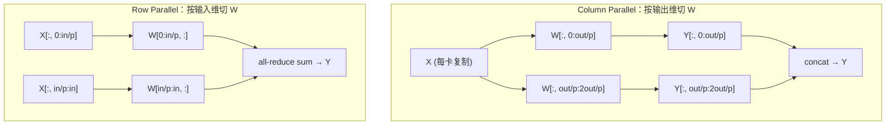

# 08 TP、benchmark 与项目包装：把 MiniEngine 讲成项目

> **目标**：补上最后两块拼图——Tensor Parallel 的切法与通信量，
> 以及一套可复现的 TTFT/TPOT/吞吐 benchmark；最后把整个 MiniEngine
> 讲成面试官愿意追问 20 分钟的项目。
>
> **代码**：
> [`code/tp_sim.py`](./code/tp_sim.py)、
> [`code/benchmark.py`](./code/benchmark.py)
> **依赖**：Python 3.10+、`numpy`；benchmark 复用 v2 调度器
> **验收**：列切/行切输出与单卡一致；能手算 all-reduce 通信量；
> 能解释 batch=2 为什么比 serial 快、TPOT 为什么变差；能写出项目
> README 的六段式。

## 一、TP 直觉：把一个大矩阵拆给多张卡

Tensor Parallel（TP）不是「把模型切成几段」，而是**把同一个矩阵乘
拆到多张卡上，每张卡算一部分，再拼/求和**。

两种基本切法：



### 1.1 Column Parallel

```text
W = [W_1 | W_2 | ... | W_p]        （按输出维切）
Y_i = X · W_i
Y = [Y_1 | Y_2 | ... | Y_p]
```

- 每张卡拿到完整的 `X`，算一部分输出列；
- 如果下一层能直接消费分片的 `Y`（如 MLP 的 up-projection），
  **不需要 all-reduce**；
- 如果下一层需要完整 `Y`，才做 all-gather。

### 1.2 Row Parallel

```text
W = [W_1; W_2; ...; W_p]           （按输入维切）
X = [X_1 | X_2 | ... | X_p]        （按输入维切）
Y_i = X_i · W_i
Y = Σ_i Y_i                        （all-reduce sum）
```

- 每张卡拿到一部分输入和一部分权重；
- 输出是**部分和**，必须 all-reduce 求和；
- MLP 的 down-projection、attention 的 output projection 都用这个。

### 1.3 一个 MLP 的 TP

```text
Y = ReLU(X · W1) · W2
```

- `W1`：`h → 4h`，**column parallel**；
- `W2`：`4h → h`，**row parallel**；
- 每个 MLP 层一次 all-reduce。

### 1.4 通信量公式

Ring all-reduce 的通信量：

```text
allreduce_bytes = 2 × (p - 1) / p × B × S × H × bytes_per_elem
```

例子：`B=8, S=2048, H=4096, BF16, p=4`：

```text
2 × 3/4 × 8 × 2048 × 4096 × 2 = 192 MiB / layer
```

这还只是一层、一个 all-reduce。70B 模型 80 层、每层两次通信，
TP 的通信量非常可观——所以 **TP 通常只放在机内 NVLink 域**，
不跨机。

## 二、跑 TP 模拟

```bash
cd projects/从零实现推理引擎
python3 code/tp_sim.py
```

输出：

```text
=== 1) MLP 列切 + 行切 ===
ref shape: (16, 16) tp shape: (16, 16)
max |diff|: 2.78e-17

=== 2) 单层列切 / 行切 ===
column parallel max diff: 0.0
row parallel max diff: 2.78e-17

=== 3) all-reduce 通信量（BF16） ===
B= 1, S=2048, H=4096, world=4: 24.0 MiB / layer
B= 8, S=2048, H=4096, world=4: 192.0 MiB / layer
B=32, S=2048, H=4096, world=4: 768.0 MiB / layer
```

- 列切/行切的数值结果与单卡一致（误差 1e-17）；
- 通信量随 batch 线性增长；
- 真实 TP 还要考虑 all-reduce 的延迟、NVLink 带宽、TP 与 EP 的组合。

## 三、Benchmark：怎么证明它真的快

### 3.1 四个指标

| 指标 | 定义 | 看什么 |
|---|---|---|
| **TTFT** | 请求进来到第一个 token | 首字体验，prefill + 排队 |
| **TPOT / ITL** | 相邻输出 token 间隔 | 打字机流畅度，decode |
| **吞吐** | 输出 token / 墙钟 | 单位成本，batch |
| **goodput** | 满足 SLO 的 token / 墙钟 | 真实业务价值 |

只看吞吐会被「把 batch 拉到无限大」骗；只看 p50 会被长尾骗。
报告至少给 **p50 + p99**，并写清 SLO。

### 3.2 workload 设计

不要只测一个固定 prompt。至少覆盖：

- 输入长度分布：短 prompt、2K、8K、32K；
- 输出长度分布：短回答、长文、代码；
- 并发：1、4、16、64；
- 到达模式：Poisson / burst / 固定 QPS；
- 冷/热 prefix cache 两种口径。

### 3.3 测量纪律

- **warmup**：先跑几十步，排除编译、CUDA Graph capture、page cache；
- **steady state**：只统计稳定阶段，不把冷启动算进吞吐；
- **同一硬件/同一模型/同一精度**：否则数字不可比；
- **报告 p50/p99 与 SLO**：不要只报平均值；
- **保留原始 trace**：面试官问「为什么这个点掉了」时能回查。

### 3.4 跑本仓 benchmark

```bash
python3 code/benchmark.py
```

输出（CPU toy 口径）：

```text
      config |  speedup |    tok/s |  TTFT p50 |  TPOT p50
      serial |    1.00x |   1504.8 |     0.68ms |     0.66ms
     batch=1 |    1.00x |   1501.2 |     0.68ms |     0.66ms
     batch=2 |    1.62x |   2435.6 |     0.73ms |     0.84ms
     batch=3 |    1.54x |   2310.0 |     0.68ms |     1.02ms
     batch=6 |    1.54x |   2310.8 |     0.68ms |     1.13ms
```

怎么读：

- **batch=2 是甜点**：吞吐 1.62×，TPOT 只从 0.66 涨到 0.84ms；
- **batch=3/6 没有更高**：toy workload 只有 6 个请求、到达有先后，
  batch 再大也填不满；真实 GPU 上曲线会不同；
- **TPOT 随 batch 上升**：这是吞吐换延迟的直接证据；
- 不要背 toy 数字，要背**方法论**：同一 workload、同一 delay、逐项
  对照。

## 四、项目包装：把 MiniEngine 讲成 20 分钟

### 4.1 README 六段式

1. **问题**：为什么需要推理引擎（KV 显存、batching、调度）；
2. **架构图**：engine / scheduler / block manager / model runner /
   sampler；
3. **关键机制**：KV Cache、continuous batching、PagedAttention、
   prefix cache、sampling、CUDA Graph；
4. **benchmark**：TTFT/TPOT/吞吐，p50/p99，SLO；
5. **失败案例**：OOM、长 prefill 饿死 decode、prefix 污染、graph
   re-capture；
6. **增量与边界**：和 nano-vllm/mini-sglang 比，你多做了什么；
   哪些没做（TP、chunked prefill、量化）。

### 4.2 五层追问叙事

面试官通常按这个顺序挖：

1. **为什么做**：vLLM 用过，但说不清调度器；想自己写一遍；
2. **架构**：请求怎么进 waiting/running、KV 怎么分配、batch 怎么拼；
3. **机制**：PagedAttention 为什么省碎片、RadixCache 怎么命中、
   CUDA Graph 为什么省 launch；
4. **取舍**：batch 大小 vs TPOT、block size vs 浪费、graph vs 动态 shape；
5. **验证**：benchmark 怎么测、p99 怎么解释、失败案例怎么复盘。

### 4.3 增量改造清单（选 1–2 个）

- **chunked prefill**：长 prefill 切块，和 decode 混批；
- **prefix cache 命中率**：加 tenant salt、只缓存高频前缀；
- **TP**：把 `tp_sim.py` 接到真实多卡，量 all-reduce 占比；
- **CUDA Graph**：给 decode 加 batch 桶，量 break-even；
- **调度策略**：FCFS → 优先级/aging，量 p99 与饥饿；
- **benchmark 报告**：把 toy 换成 Qwen2.5-0.5B，给出真实 GPU 曲线。

### 4.4 不要做的三件事

1. **不要说「复刻了 vLLM」**：nano-vllm 已经烂大街，复刻跑通不算项目；
2. **不要只报一个吞吐数字**：没有 TTFT/TPOT/p99/SLO，数字没有意义；
3. **不要掩盖失败**：OOM、re-capture、NCCL hang 才是面试官想听的
   「你真做过」的证据。

## 五、系列总结：我们从 0 走到了哪

| 版本 | 机制 | 关键收获 |
|---|---|---|
| v0 | 单请求 while 循环 | 引擎就是一个「forward → sample → append」循环 |
| v1 | KV Cache + prefill/decode | O(T²)→O(T)，KV 显存公式 |
| v2 | continuous batching | waiting/running、动态准入、吞吐 vs TPOT |
| v3 | PagedAttention + BlockManager | block table、引用计数、前缀共享 |
| v4 | RadixCache | match/insert/evict、fork_prefix、LRU |
| v5 | 采样与停止条件 | temperature/top-k/top-p/penalty/stop |
| 07 | CUDA Graph | launch overhead、break-even、动态 shape |
| 08 | TP + benchmark | 列切/行切、all-reduce、TTFT/TPOT/吞吐 |

你现在应该能回答：

- 「一个请求从进来到出第一个 token，中间发生了什么？」
- 「KV Cache 为什么省计算不省显存？公式是什么？」
- 「continuous batching 为什么提吞吐？代价是什么？」
- 「PagedAttention 怎么解决碎片？引用计数怎么工作？」
- 「前缀缓存命中后，哪些计算可以跳过？」
- 「temperature/top-p 在做什么？stop 条件怎么设计？」
- 「CUDA Graph 什么时候值得上？break-even 怎么算？」
- 「TP 的列切/行切分别在哪通信？通信量怎么估？」

## 六、本章验收

### 必做

1. 跑通 `tp_sim.py`，确认列切/行切与单卡误差 < 1e-12。
2. 手算 `B=8, S=2048, H=4096, BF16, p=8` 的 all-reduce 通信量。
3. 跑通 `benchmark.py`，解释 batch=2 的 speedup 与 TPOT 变化。
4. 给自己的 MiniEngine 写一份六段式 README（问题/架构/机制/
   benchmark/失败案例/增量）。

### 选做

1. 把 `benchmark.py` 换成真实 Qwen2.5-0.5B，给出 GPU 上的
   TTFT/TPOT/吞吐曲线。
2. 给 `tp_sim.py` 加一个 ring all-reduce 的逐 rank 模拟，统计
   `2(p-1)/p` 的通信步数。
3. 把 v2 的调度器接上 v3 的 BlockManager，跑一个「block 不足时排队」
   的端到端 demo。

### 面试收尾口播

> 「我从零写了一个 MiniEngine：v0 是单请求循环，v1 加 KV Cache，
> v2 加 continuous batching，v3 用 PagedAttention 管 KV block，v4
> 加 RadixCache 前缀复用，v5 补采样与停止条件；另外用模拟器量了
> CUDA Graph 的 break-even 和 TP 的通信量。项目里最有价值的不是
> 代码量，而是每个机制的取舍和 benchmark 口径。」

## 七、系列之后

如果你想继续往深里走：

- 读 [nano-vllm](https://github.com/GeeeekExplorer/nano-vllm) 的
  `engine/` 与 `core/`，对照本系列的 v2/v3；
- 读 [mini-sglang](https://github.com/sgl-project/mini-sglang) 的
  `radix_cache.py` 与 chunked prefill，对照 v4；
- 读仓内
  [源码学习路线图](../../interview-questions/inference/源码解读/源码学习路线图.md)，
  把 MiniEngine 的模块映射到 vLLM/SGLang 真源码；
- 选一个增量（chunked prefill / prefix cache / TP / CUDA Graph），
  做成可复现的 benchmark 报告。

系列目录：[从零实现推理引擎](./README.md)。
